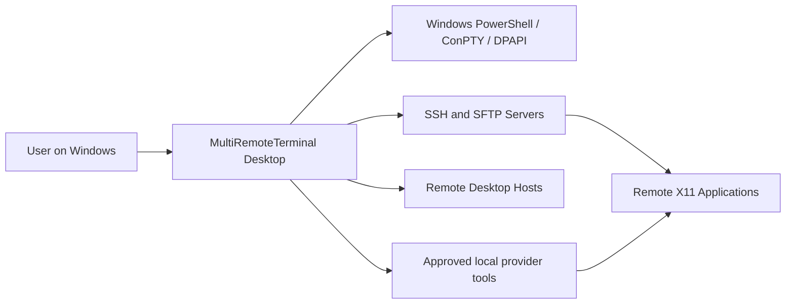
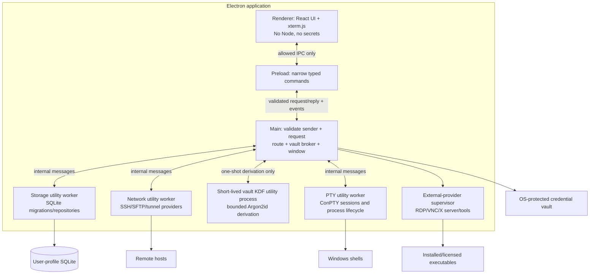
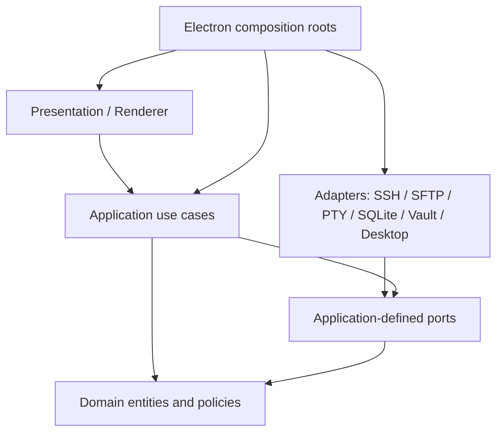
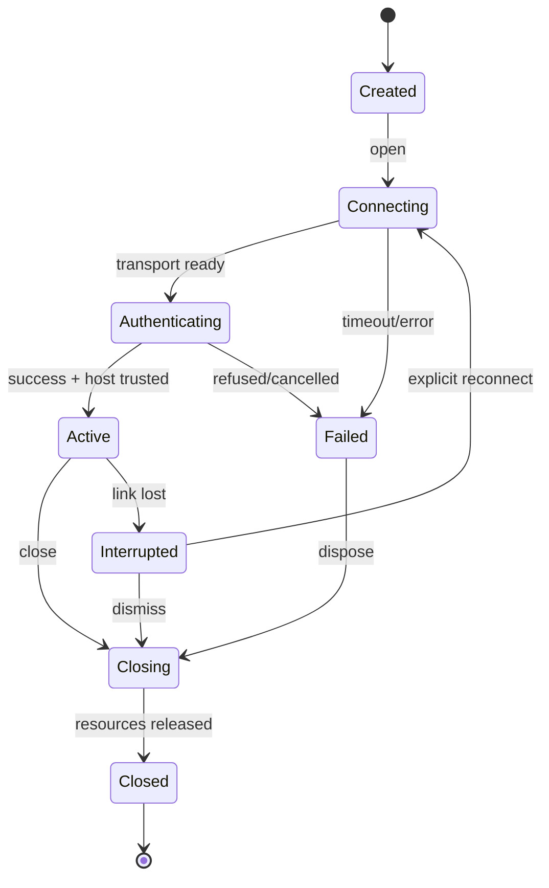

# MultiRemoteTerminal — Clean Architecture

**Architecture baseline:** ADR-0001; independent modular monolith, desktop only. All interfaces below are **design contracts**, not implementation source.

## 1. System context



## 2. Processes and trust



**Trust notes.** Utility workers isolate crashes and responsibility, but they still run privileged Node.js code and must **not** be treated as an OS security sandbox. Renderer content has no direct operating-system authority. Terminal output is **untrusted text** and is never rendered as privileged HTML. Remote hosts and third-party tools are untrusted peers. IPC sender IDs, origins and per-command permissions are validated by the main broker.

## 3. Dependency direction



- **Domain** is framework-free: connection definitions, session and tunnel rules, macro policies, provider capabilities, errors, value objects.
- **Application** coordinates one user intention per use case; owns state machine orchestration and transactions.
- **Ports** describe operations the application requires; no transport/library detail in interfaces.
- **Adapters** translate protocols and storage details; tested against port-level contract suites.
- **Presentation** owns layout, focus, accessibility, transient UI state. It does not know SQLite or ssh2 types.
- **Composition roots** construct concrete dependencies and negotiate availability of optional providers.
- The main process remains responsive while the synchronous Argon2id operation runs in a dedicated short-lived utility process. The process returns a derived key only to main, and never handles SSH connections or renderer requests.

Avoid a giant `SessionManager` with switch statements for each protocol. Use **capability discovery** and independent adapters while sharing lifecycle/use-case primitives.

## 4. Proposed repository layout (architecture map, not actual files)

```text
apps/desktop/
  src/main/             app boot, secure window, policy, IPC router, worker supervision
  src/preload/          typed allowlisted application bridge
  src/renderer/         shell chrome, tabs, terminal panes, sidebar, dialogs, status
  src/workers/          network, terminal, storage worker entrypoints
packages/
  domain/               entities, IDs, validation, lifecycle rules, error types
  application/          use cases, orchestration, ports, projections
  contracts/            IPC DTOs, event definitions and versioned validation schemas
  adapters/
    ssh/                SSH authentication, remote shell, host-key policy, forwarding
    sftp/               directory listings, transfers, remote file edit saves
    ftp/                explicit FTPS / consent-gated FTP directory browsing and transfers
    local-pty/          ConPTY backend
    persistence/        SQLite schema, migrations, repositories
    credential-vault/   Windows-protected secrets and master-password envelope
    desktop-providers/  RDP, VNC, X11, XDMCP, Mosh, serial, legacy tools
    daemons/            lifecycle and provider-specific control
  ui/                   design tokens and reusable accessible primitives
  test-support/         in-memory adapters, fake clocks, test SSH servers
docs/                   specs, decisions, REA evidence, compatibility
```

Directories may be simplified if the actual implementation does not justify separate packages, but **dependency rules remain**. Prefer a `pnpm` workspace with TypeScript project references; strict TypeScript and linted import boundaries.

## 5. Deep-module interface inventory

These are conceptual operations; Codex determines exact types and implementation.

| Port / module | Minimal interface operations | Invariants and implementation hiding |
|---|---|---|
| `SessionCatalog` | `save`, `list`, `get`, `delete`, `search` | Persist definitions only; never write runtime sockets or plaintext secrets |
| `ConnectionRuntime` | `open`, `write`, `resize`, `close`, `subscribe` | One stream owner per runtime ID; idempotent close; bounded byte buffers |
| `ProviderRegistry` | `available`, `capabilities`, `create` | One uniform discovery seam; unsupported capability is explicit, not silent |
| `HostTrustStore` | `verify`, `trustAfterApproval`, `revoke` | Reject unknown/changed keys by default; exact endpoint and key algorithm |
| `SecretVault` | `store`, `resolveForOperation`, `delete`, `lock`, `unlock` | Credential bytes never cross to renderer; distinguish unavailable vs locked |
| `TunnelController` | `start`, `stop`, `getStatus`, `subscribe` | Atomic startup; no daemonized orphan listeners; default loopback |
| `FileTransferController` | `list`, `queueCopy`, `cancel`, `watchProgress`, `openRemoteFile` | Temporary paths, collision policy, symlink policy, integrity before replace |
| `MacroRunner` | `validate`, `run`, `cancel` | Never record passwords; explicit target allowlist and approval for broadcast |
| `DaemonController` | `start`, `stop`, `status`, `readLogs` | No artificial timer; explicit bind, authorization and cleanup |
| `SettingsCatalog` | `get`, `update`, `exportRedacted`, `import` | Schema version, transactional changes, no secret export by default |

A port must document the success return, cancellation semantics, timeout, auth failure, state transition and resource ownership. Do not create port interfaces solely because classes exist; a port is justified by test substitution or independent integration.

The saved-folder bundle file-dialog port is an interactive OS operation: Windows open/save pickers settle only after explicit user selection or dismissal, and Electron exposes no abort signal or deadline for these methods. The renderer therefore waits without an IPC timeout while the modal picker is open. The native Cancel button dismisses it; a caller cancellation that arrives meanwhile is checked as soon as the picker settles, and no selected path is used for storage. Storage work starts only after that check and retains its own bounded worker timeout/cancellation. When a storage timeout or cancellation terminates the worker, its request settles only after worker exit and tracked temporary-file cleanup complete.

## 6. IPC contract (version 1)

All commands carry `{requestId, contractVersion, payload}`. All results carry `{requestId, ok, result|error}`. Event subscriptions include an owner/session ID and an explicit unsubscribe operation. Validate payload shape and sizes on the main side; reject unknown commands. IPC transport errors use stable codes and localized display text at the UI edge.

| Command family | Representative commands | Events |
|---|---|---|
| Sessions | `sessions.list`, `sessions.save`, `sessions.delete` | `sessions.changed` |
| Runtime | `runtime.open`, `runtime.input`, `runtime.resize`, `runtime.close` | `runtime.status`, `runtime.output`, `runtime.exit` |
| Files | `files.list`, `files.upload`, `files.download`, `files.cancel` | `files.progress`, `files.finished` |
| Tunnels | `tunnels.list`, `tunnels.save`, `tunnels.start`, `tunnels.stop` | `tunnels.status` |
| Macros | `macros.save`, `macros.run`, `macros.cancel` | `macros.step`, `macros.finished` |
| Credentials | `vault.lock`, `vault.unlock`, `vault.save` | `vault.state` |
| Integrations | `providers.capabilities`, `providers.launch` | `providers.status` |
| Settings | `settings.get`, `settings.patch` | `settings.changed` |

**Data size**: `runtime.output` should be binary streaming or short bounded chunks with delivery acknowledgements; never send megabyte-scale blobs as unbounded synchronous IPC. Throttle session events to avoid starving typing. UI supports 60 fps scroll under normal conditions, not a promised framerate for infinite output.

## 7. Runtime state and algorithms

### Session lifecycle



**Open:** validate definition -> resolve provider -> resolve credential in main only -> establish transport -> verify host key -> authenticate -> request PTY/shell -> allocate bounded stream -> emit active. On any error dispose partially-created resources in reverse order and emit a stable error. No automatic replay of user input on reconnect.

**Tunnel start:** validate host/ports and binding policy -> establish trusted/authenticated SSH transport -> attempt listener/remote-forward reservation -> mark ACTIVE **only after** successful bind -> forward bytes with backpressure and paired shutdown -> on stop unbind and close sockets. Remote/dynamic forwarding is opt-in; non-loopback listeners require explicit confirmation.

**Macro run:** use structured steps (`text`, `delay`, `waitForPattern`, `confirm`) rather than a script interpreter initially; validate step limits, target list and runtime readiness -> request explicit confirmation for multi-target broadcast -> enqueue a cancellable per-target run -> abort on a target failure according to configured stop policy; never auto-retry destructive steps. `waitForPattern` uses bounded output window and timeout.

**WP-06A macro library:** framework-free macro definitions use a versioned exact schema with ordered `send`, literal `waitForText`, bounded `delay` and `confirm` steps. The application catalog validates CRUD operations and delegates persistence through typed commands to the SQLite storage worker. The renderer reaches it only through preload IPC. The catalog has no count limit; each definition has bounded step count and text size. No credential or session fields are stored. Macro text is user-authored local database content and may contain sensitive text, so the editor warns users not to enter passwords, tokens or private-key content; it does not pattern-detect manually entered secrets.

**WP-06B1 macro recording:** an application-layer recorder owns one selected terminal's transient input and prompt-detection state. It stores only completed lines in memory, applies the macro step, line and total-text limits (reserving the macro name's text budget), omits clipboard paste and observes terminal output only transiently after stripping CSI, OSC, DCS, SOS, PM and APC control sequences in 7-bit and C1 forms. At recording start, it inspects only the target terminal's current xterm cursor line to detect a prompt that was already open. While paused, it keeps a bounded transient prompt line and latches recognized secret-prompt state until input is submitted or canceled with Ctrl+C; Resume while a recognized prompt remains open keeps recording paused and suppresses input. Recognized prompts, including repeated prompt names, suppress input and pause recording after submission. For recognizable full-screen redraws, a bounded row map follows common CSI cursor movement/erase controls and checks the cursor row so previous visible rows are not reprocessed as new prompts. Prompt matching and redraw classification are heuristic and cannot guarantee detection of arbitrary secrets or terminal redraw styles. No terminal output or transcript is persisted. Save errors report their code, target and retry/discard actions.

**WP-06B2 macro playback:** a framework-free application runner accepts one validated macro and one explicitly selected running local, SSH or Telnet terminal. It sends authored one-line input through the existing typed terminal commands, serializes one active run, reports step progress, waits for case-sensitive literal output in a 64 KiB transient text window with the authored bounded timeout, schedules bounded delays through an injected timer port, and pauses at each authored confirmation until the user continues. The output reader strips ANSI/control strings as chunks arrive and retains no terminal transcript after the run ends. Cancellation stops waits, delays and confirmations and prevents later steps. A terminal write already in flight is not retracted; the runner waits for its typed reply or the existing five-second renderer reply deadline. A timeout does not prove the underlying invocation was rejected, and playback does not retry it. Terminal failure, close or disconnect also stop the run. The renderer previews the exact saved steps and target before the explicit Run action and disables manual input to the selected terminal during playback. Playback does not reconnect, resume or rerun automatically.

**WP-06C MultiExec:** a framework-free application runner accepts one validated, non-empty, single-line input (maximum 4,096 characters) and two to 256 distinct, explicitly selected running local, SSH or Telnet terminals. Validation rejects control characters, Unicode line/paragraph separators and bidirectional formatting controls so the exact review remains visually stable. The renderer shows the exact text and every destination, then requires a separate final confirmation. The runner performs at most four writes concurrently through the existing typed terminal commands, keeps per-target status isolated, does not capture output or retry, and stops starting queued writes after cancellation while awaiting writes already in flight. TIMEOUT and UNAVAILABLE replies are reported as uncertain because the remote side may have received the input; other failures are scoped to that target. Renderer state blocks manual input to selected targets during review and send, and prevents overlap with macro recording or playback. Result status receives keyboard focus when the run starts and finishes. No target list, command text or result is persisted or logged. Windows E2E covers three distinct loopback SSH hosts; unit tests cover target validation, final approval, bounded sends, per-target failure, no retry, uncertain delivery and queued cancellation.

**WP-06E macro shortcuts:** shortcut assignments use a dedicated typed domain value, application catalog methods and allowlisted storage/preload commands. The renderer captures only Ctrl+Alt+Shift plus an allowlisted physical key, rejects AltGraph and unsupported modifiers, and opens the exact macro review for the current active local, SSH or Telnet terminal when it is running; otherwise it preselects the first running supported terminal, which the user can change before Run. The shortcut never starts playback; the existing explicit Run action remains required. Schema v3 adds the unique, cascading `macro_shortcuts` table without changing target preset semantics in `macro_bindings`. Windows E2E covers persistence, activation and the approval boundary.

A WP-06B2 wait step searches the sanitized 64 KiB output collected since playback started, including output from earlier steps in that run; it does not inspect terminal scrollback from before the run.

**SFTP upload/download:** resolve the user-selected destination and symlink policy -> offer overwrite/rename/skip -> stream through a sibling temporary path -> commit with the server/filesystem's no-replace operation unless overwrite was explicitly selected -> attempt bounded partial cleanup on cancellation. Treat path values as data, never shell-interpolate; see the implemented WP-05B boundaries below.

**WP-05A directory listing:** a trusted, running SSH session may open its SFTP subsystem on demand and list one remote directory. The application validates each remote path component at the IPC, application and worker boundaries, resolves the request through SFTP `realpath`, reads a bounded directory handle, caps output at 500 entries, and reports truncation. The renderer receives only validated names, metadata and normalized paths through the typed `ssh.files.list` command. Symlinks are identified and displayed without following them. Cancellation while opening the subsystem settles the caller promptly but retains a per-session busy guard and 15-second watchdog until the server callback arrives or the SSH session closes; a late channel is closed. If no callback arrives before the watchdog, the SSH transport closes so an unknown channel cannot remain unowned. A listing cancellation or timeout closes the active SFTP channel while preserving the shell when possible; only one SFTP operation may run per SSH session. The subsystem setup and listing budgets are 15 and 10 seconds; the worker host allows 30 seconds for the combined request and IPC margin, and the preload waits up to 35 seconds for the worker's bounded result. This slice does not implement transfers.

**WP-05B SFTP transfers:** upload and download commands carry only a session, operation ID, remote path and conflict policy through typed IPC; the main process selects local paths through native dialogs, and those paths are sent only to the SSH utility worker. Transfers reuse the already trusted SSH client and its SFTP subsystem, are serialized one per session, stream with backpressure, publish typed progress at most every 100 ms plus the final byte count, and use a 30-second idle timeout plus a one-hour overall request deadline. Upload sources are opened in the worker and checked against their path identity and byte count before commit. Before remote I/O and again before commit, the worker compares server `realpath` with the normalized requested path and `lstat`s the final object to reject known symlink ancestors. Remote uploads use random exclusive sibling `.partial` files; the SFTP v3 rename operation commits the temp file, relying on the protocol rule that an existing destination is an error. Explicit overwrite temporarily moves the existing file to a random sibling backup, compares its available metadata identity, replaces it, and restores the backup if replacement fails when safe to do so. Downloads check remote source identity around streaming and require the advertised byte count when available before completing the staged local target. Downloads use a random local sibling temp file and a no-replace hard-link commit for new or renamed destinations; overwrite verifies the selected target identity before replacing it. The local overwrite rename has a small check-to-rename race because Windows provides no identity-conditional rename. Since SFTP v3 is path-based, a hostile remote peer can still race a path-component swap between a check and its use. A progress transition into `committing` disables cancellation; a delayed commit event extends any existing cancellation cleanup grace, while other pre-commit cancellation and worker deadlines attempt stream/temp cleanup. Forced worker termination or connection loss can leave partial data. The Windows loopback SFTP fixture verifies upload and download bytes across the UI, broker, worker and filesystem. Standalone SFTP, drag/drop, 100 MB transfers, disconnect recovery and broad server interoperability remain unverified. See [ADR-0007](adr/ADR-0007-sftp-transfer-commit.md).

**WP-05C standalone SFTP:** `sftp.open` and `sftp.close` are fixed typed IPC commands into the SSH application controller; the ordinary first-use host-trust decision and native credential prompt are reused. The SSH worker authenticates the endpoint, then returns from its `ready` callback without requesting a PTY or shell. The resulting files-only runtime can use the existing `ssh.files.*` list/transfer operations; terminal input, output acknowledgement and resize are rejected for this mode. It shares the SSH transport lifetime and supervised worker cleanup, while the renderer presents a files tab without a terminal surface. Saved profiles are credential-free; SQLite persists them in the existing `ssh` row form with the strict `options_json` marker `sftpOnly: true`, which decodes to the domain-level `sftp` kind. Saved-folder bundle format v3 includes SFTP metadata while retaining v1/v2 import validation. The Windows loopback acceptance test exercises first-use host trust, authenticated listing and download bytes, save/reopen and verifies no shell request; see [ADR-0008](adr/ADR-0008-sftp-only-sessions.md). Drag/drop, large-file throughput, disconnect/recovery and broader SFTP server compatibility remain unverified.

**WP-04A loopback local SSH forwarding:** a persisted definition references a saved SSH profile and contains a label, bind port and remote target. Explicit start opens a separate files-only SSH runtime through the existing host-trust and credential flow; it requests no PTY, shell or SFTP subsystem. The SSH worker owns the loopback listener and forwarded channels. The controller reports active only after bind success and closes the listener and SSH runtime together. Listener sockets preserve TCP half-close behavior. Definitions do not auto-start and runtime status is not persisted. This first slice binds only to `127.0.0.1`; port `0` permits OS assignment. Later WP-04 slices add loopback-requested remote and dynamic forwarding, plus SSH gateway routes. Public bind controls and consent remain open. See [ADR-0009](adr/ADR-0009-wp04a-local-ssh-forwarding.md).

**WP-04B loopback remote SSH forwarding:** the shared tunnel model persists local and remote direction. An explicit start opens a dedicated files-only SSH runtime and requests a remote `127.0.0.1` bind with `forwardIn`; port `0` is replaced by the server-assigned port only after bind confirmation. The SSH utility worker accepts matching forwarded channels, connects each to the configured local destination, and bridges the streams with a 64-connection bound and 15-second channel-open timeout. Stop calls `unforwardIn` with a 1.5-second bound, closes paired sockets/channels and closes the SSH runtime. Shutdown tears down the transport so any unacknowledged server bind also ends with the connection. Server policy, including `GatewayPorts`, may broaden the actual bind; the manager warns about this before start. Non-loopback bind controls and consent remain open; dynamic and gateway routes are covered by WP-04C/D. See [ADR-0010](adr/ADR-0010-wp04b-remote-ssh-forwarding.md).

**WP-04C dynamic SSH SOCKS5 forwarding:** a persisted destination-free definition starts an explicit loopback-only SOCKS5 listener over a files-only SSH runtime. The SSH worker supports no-authentication TCP `CONNECT` to IPv4, domain-name and IPv6 destinations; domain resolution occurs on the SSH server. Pending/open clients are bounded to 64, channel setup to 15 seconds, and stop closes the listener, sockets and channels. Authentication methods, `BIND`, `UDP ASSOCIATE` and broad interoperability remain open. See [ADR-0011](adr/ADR-0011-wp04c-dynamic-socks-forwarding.md).

**WP-04D SSH gateway routes:** a saved SSH target can be opened through up to two selected saved SSH gateway profiles. The route is selected per connection and is not persisted with the target or exported in saved-folder bundles. The renderer sends profile IDs only; the main broker resolves and validates SSH definitions before calling the SSH controller. The application requests credentials separately in route order with gateway/destination labels. The supervised SSH worker opens each hop over the prior client's `forwardOut` channel, verifies each endpoint's host key independently, and requests a shell only from the final destination. A 15-second deadline bounds each inter-hop channel open and the existing 130-second overall open deadline bounds the chain. On failure, close or shutdown, every channel and client is torn down. Windows E2E covers one and two gateways, independent first-use trust for each endpoint, terminal output and cleanup. The UI and worker accept at most two gateways; routes through SFTP-only target sessions, tunnels through gateways, public-server interoperability and longer chains remain open. See [ADR-0012](adr/ADR-0012-wp04d-ssh-gateway-routes.md).

**WP-09B Telnet terminal:** the UI requires a fresh, visible plaintext warning acknowledgement for each connection, including each saved-profile reopen. The profile stores only the canonical host and port; login data is typed into the remote terminal and is not intercepted or persisted. Typed `telnet.*` IPC crosses the preload and main broker into a supervised Electron utility worker; the worker owns the TCP socket and protocol codec. The codec incrementally parses Telnet IAC commands, bounds subnegotiation payloads to 512 bytes, handles NVT line endings until BINARY is accepted, and supports BINARY, Suppress Go Ahead, remote ECHO, NAWS and fixed `XTERM-256COLOR` terminal type. Terminal output is UTF-8 decoded, sequence-acknowledged and backpressured; input queues are bounded. TCP connection establishment is limited to 12 seconds, the worker open request to 15 seconds, and the preload IPC wait to 20 seconds. Close, timeout, worker crash and application shutdown destroy the socket and settle pending operations. Telnet carries terminal bytes without encryption and must not be used for secrets or untrusted networks. Windows loopback E2E exercises the UI, warning, TCP negotiation, terminal input/output, catalog save and consent-gated reopen; this does not claim interoperability against every historical Telnet server.

**WP-09C FTP/FTPS browser and WP-09D transfers:** FTP endpoints are credential-free saved definitions; the `secure` option selects explicit FTPS, which is the connect-dialog default. FTP usernames/passwords come from the separate Windows credential prompt and are sent only to a dedicated utility worker. The `basic-ftp` client is serialized per connection, uses a 30-second server-progress timeout, caps parsed directory data at 2 MiB and results at 500 entries, suppresses protocol logging, and refuses PASV transfer hosts that differ from the control host. Every plaintext FTP connection needs a short-lived, one-use trusted submit gesture bound to the visible host and port and independently consumed by the main broker. Paths and replies are validated at the domain, IPC and worker boundaries. The renderer requests upload or download using only a session and remote path; main obtains local paths through native dialogs, and those paths cross only the private worker protocol. One transfer per FTP session streams through the supervised worker and publishes typed progress, including the finalizing phase. Non-overwrite uploads use standard argumentless `STOU` in the requested directory; the worker temporarily changes CWD, validates the server-reported unique path, then restores the prior directory. The server chooses the uploaded filename, and the in-progress file is visible to other listing clients. On cancellation the worker captures the path before data starts, ends the stream cleanly and attempts `DELE` while the control channel remains available; connection loss can leave remote residue. If STOU is rejected, upload fails closed. Explicit overwrite stages a random sibling and uses a backup/replace sequence where the server permits it; this is not atomic on all servers. Downloads use a sibling local temporary file and a no-replace commit, with explicit overwrite/rename/skip/cancel handling. A committing phase blocks cancellation. At the one-hour request deadline, an active commit gets a bounded two-minute settlement window for the FTP command sequence and rollback; if still stuck, forced termination can leave `.backup` and `.partial` recovery files. Other timed-out operations get a two-second cleanup grace. Windows loopback E2E verifies standard argumentless STOU, selected-directory CWD/restore, upload, download, the renderer-to-worker flow and profile persistence/reconnect. FTPS certificate interoperability and broader FTP acceptance remain open. See [ADR-0006](adr/ADR-0006-ftp-no-clobber-uploads.md) for the unique-store decision and its limitations.

## 8. SQLite logical schema (v3)

Use `TEXT` UUIDs for IDs, UTC ISO-8601 timestamps, foreign keys enabled, unique constraints, WAL mode, transactional migrations. Database file stored in per-user `app.getPath('userData')`. Database has no secret plaintext; `credential_ref` points to the vault. The selected built-in `node:sqlite` driver runs only in the storage utility process; see [ADR-0005](adr/ADR-0005-node-sqlite-storage-worker.md) and the [WP-03 runtime review](dependencies/WP-03.md).

| Table | Fields (type; required where noted) | Important rules |
|---|---|---|
| `folders` | `id TEXT PK`, `parent_id TEXT FK?`, `name TEXT NOT NULL`, `sort_order INTEGER` | Detect and reject cycles; cascade policy on folder deletion asks user |
| `session_definitions` | `id TEXT PK`, `folder_id TEXT FK?`, `kind TEXT`, `name TEXT`, `host TEXT?`, `port INTEGER?`, `username TEXT?`, `credential_ref TEXT?`, `options_json TEXT`, `options_version INTEGER`, `favorite INTEGER`, `created_at TEXT`, `updated_at TEXT` | `kind` enum: `local`, `ssh`, `telnet`, `rlogin`, `mosh`, `rdp`, `vnc`, `serial`, `ftp`, `xdmcp`; validate ports 1..65535 for network transports; no runtime details. Telnet records contain only the canonical endpoint; FTP records contain the canonical endpoint and explicit-FTPS flag. Neither profile stores account credentials. |
| `session_tags` | `session_id TEXT FK`, `tag TEXT`, composite PK | Search and classification |
| `tunnel_definitions` | `id TEXT PK`, `session_id TEXT FK`, `name TEXT`, `mode TEXT`, `bind_host TEXT`, `bind_port INTEGER`, `target_host TEXT?`, `target_port INTEGER?`, `enabled INTEGER`, `created_at TEXT` | `mode=local/remote/dynamic`; no limit on records; binding validated at start; definitions are independent of live sockets |
| `macro_definitions` | `id TEXT PK`, `name TEXT`, `description TEXT?`, `steps_json TEXT`, `schema_version INTEGER`, `created_at TEXT`, `updated_at TEXT` | Steps versioned and validated; no credential fields or target bindings; user-authored text can still contain sensitive data and must not include secrets |
| `macro_bindings` | `macro_id TEXT FK`, `session_id TEXT FK`, composite PK | Target presets; confirm multi-target execution |
| `macro_shortcuts` | `macro_id TEXT PK FK`, `code TEXT UNIQUE NOT NULL` | One app-wide shortcut per macro; macro deletion cascades; only allowlisted physical codes are stored |
| `ssh_host_keys` | `id TEXT PK`, `canonical_host TEXT`, `port INTEGER`, `key_algorithm TEXT`, `public_key_base64 TEXT`, `sha256_fingerprint TEXT`, `trusted_at TEXT`, `source TEXT` | One key per canonical host+port; mismatches block until explicit reset; host aliases policy defined |
| `settings` | `key TEXT PK`, `value_json TEXT`, `schema_version INTEGER`, `updated_at TEXT` | Per-key schema validation; startup greeting/logo/profile refs only |
| `file_transfer_jobs` | `id TEXT PK`, `session_id TEXT FK`, `direction TEXT`, `source TEXT`, `destination TEXT`, `state TEXT`, `bytes_total INTEGER?`, `bytes_done INTEGER`, `error_code TEXT?`, `created_at TEXT`, `updated_at TEXT` | Jobs on restart marked interrupted; do not auto-resume destructive writes |
| `provider_config` | `provider_id TEXT PK`, `path TEXT?`, `enabled INTEGER`, `capabilities_json TEXT`, `last_checked_at TEXT?` | Allowlist path, user approval, check executable provenance |
| `daemon_definitions` | `id TEXT PK`, `kind TEXT`, `bind_host TEXT`, `port INTEGER`, `config_json TEXT`, `enabled INTEGER`, `created_at TEXT` | Never auto-start external access without opt-in |
| `audit_events` | `id TEXT PK`, `kind TEXT`, `target_id TEXT?`, `outcome TEXT`, `at TEXT`, `metadata_json TEXT` | No passwords, private keys, terminal output or command bodies |

**Indexes:** `session_definitions(folder_id, name)`, `session_definitions(kind, favorite)`, `tunnel_definitions(session_id)`, `file_transfer_jobs(state, created_at)`, `ssh_host_keys(canonical_host, port)`, `audit_events(at)`. Migration numbering is monotonically increasing; backup before breaking schema migration. No hard cap on record counts.

### Credential storage contract

- Default mode: OS-backed encryption through Electron `safeStorage` **async API where supported**, with encrypted blobs stored separately from session definitions. Windows DPAPI is user-context protection, *not* isolation from malware running as the same Windows user.
- Optional master password: Argon2id-derived key, random per-vault salt and authenticated encryption (AES-256-GCM or vetted equivalent); encrypted envelopes carry format and KDF parameter versions; rate-limit unlock attempts locally and wipe references as practicable.
- Obtain passwords, passphrases and master passwords only through an explicit main-process request to the Windows native credential prompt. Resolve the PowerShell executable from Win32 `GetSystemDirectoryW`, not inherited environment variables. The renderer sends no secret and receives no secret; the one-shot helper returns to main over a private process pipe. Keep private-key selection and file reads in main.
- Avoid a home-grown cryptographic design. Select a maintained vetted library, threat-model migrations and test locked/corrupted vault behavior before enabling feature.
- Prevent plaintext logs, crash reports and clipboard leaks. Do not store secrets inside the session JSON/options or repository fixtures.
- Credentials are passed to a provider at operation time only, never exposed to the renderer.

## 9. Platform/provider strategy

| Feature | First provider route | Fallback or caveat |
|---|---|---|
| Local terminal | `node-pty` + Windows ConPTY | PowerShell/cmd plus explicitly selected installed Git Bash; broader WSL integration remains future work |
| SSH interactive | `ssh2` interactive shell | Optional separate Windows OpenSSH provider for advanced SSH config, hardware keys |
| SFTP | `ssh2` SFTP subsystem | Reuse trusted SSH lifecycle; shared host identity |
| SSH L/R/D tunnels | `ssh2` forwarding | Local and requested-loopback remote forwards plus a no-auth SOCKS5 TCP CONNECT listener use a files-only SSH runtime; dynamic forwarding supports IPv4/domain/IPv6 destinations and leaves DNS resolution to the SSH server. UDP/BIND and gateway chaining for forwarding definitions remain open; interactive SSH terminals support up to two saved gateways |
| RDP | OS `mstsc.exe` launcher | External viewer in first milestone; later integrated native RDP provider only after research |
| VNC | User-installed audited viewer | Provider path and license must be accepted; embedded version later |
| X11/XDMCP | User-installed licensed X server with capabilities probes | XDMCP insecure by nature; off by default and explicitly warned |
| Mosh | User-installed Mosh/WSL integration | UDP and server-side `mosh-server`; don't mislabel SSH as Mosh |
| FTP/FTPS | `basic-ftp` in a supervised utility worker | Explicit FTPS by default; plaintext FTP requires per-connection consent; WP-09D transfers are implemented, with cancellation/session invalidation and broader FTPS acceptance still partial |
| Telnet/Rlogin | Isolated legacy adapter or approved client | Plaintext warning for Telnet; provider-wide enable/disable remains open |
| Serial | `serialport`-style native adapter | Verify signed binary/driver and Windows COM access |
| Network daemons | Local user-scope controlled provider | Bind loopback by default; no artificial runtime timeout |
| Unix tools | WSL shell and PATH-discovered approved executables | Not equivalent to MobaXterm's built-in Unix toolset; no copying of MobApt |

Do not call a feature complete when it merely opens an unsupported-protocol error. Keep viewer integration vs fully embedded experience visibly distinguished in the feature matrix.

## 10. Windows experience

- **Information architecture:** left workspace navigation/saved sessions + top tab bar + one or more terminal panes + optional contextual SFTP pane + status bar + command palette.
- **Interaction:** drag/drop between local and remote file browser, grouped/favorite sessions, quick connect, keyboard tab navigation, accessible contrast, clear connection/host-key status.
- **Branding:** independent neutral name/logos by default; user can set welcome message, logo, profile script path, enabled tools.
- **Theme:** dark/light, high-contrast and font scale; UI state persisted separately from domain definitions.
- **Performance:** virtualized session list and file tables; terminal output flows through renderer backpressure; do not run crypto/file operations in UI thread.

## 11. Architecture fitness rules

- Domain package imports cannot mention `electron`, `react`, `node:`, `ssh2`, `sqlite` or filesystem packages.
- Renderer cannot import `node:*`, electron main, adapter packages or a credential function.
- Each adapter contract test passes against both fake adapter and production integration fixture where possible.
- All session adapters implement lifecycle and cancellation and advertise capabilities, never silently fake support.
- All persistent schema changes include forward migration test and backup/restore scenario.
- IPC must reject malformed payload, oversized output, bad sender, invalid session ownership and unknown channel.
- Resource disposal tested for process crash, network drop, cancellation, tunnel conflict and window shutdown.

## 12. Design references

https://www.electronjs.org/docs/latest/tutorial/security/
https://www.electronjs.org/docs/latest/api/utility-process
https://www.electronjs.org/docs/latest/api/safe-storage
https://github.com/microsoft/node-pty
https://github.com/mscdex/ssh2
https://xtermjs.org/docs/
https://github.com/WiseLibs/better-sqlite3
