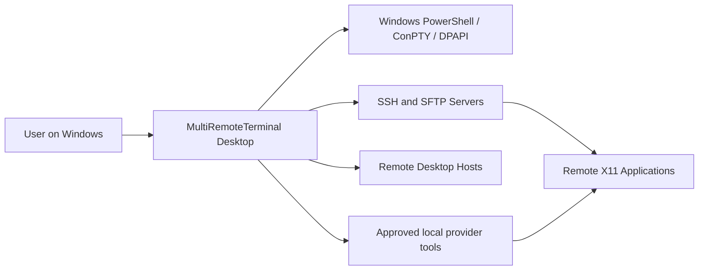
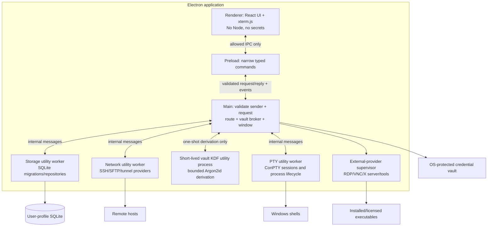
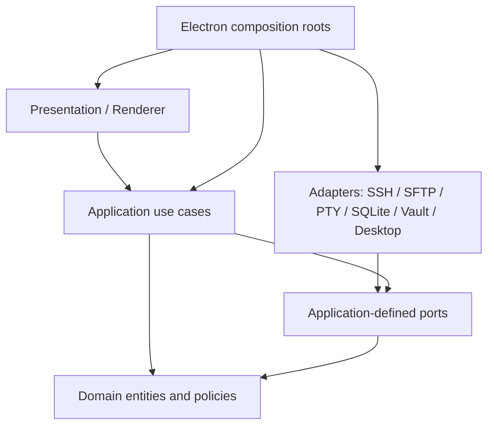
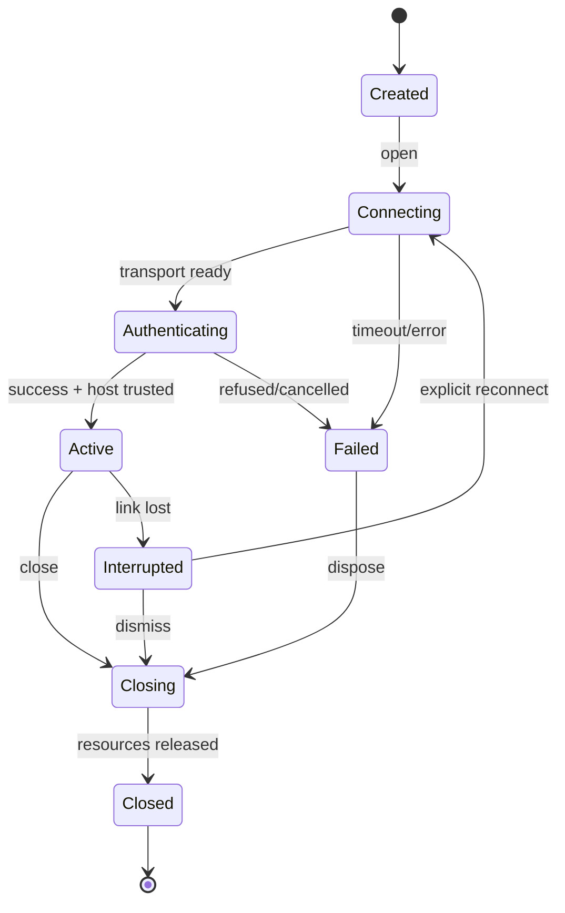

# MultiRemoteTerminal — Clean Architecture

**Architecture baseline:** ADR-0001; independent modular monolith, desktop only. All interfaces below are **design contracts**, not implementation source.

## 1. System context



## 2. Processes and trust



**Trust notes.** Utility workers isolate crashes and responsibility, but they still run privileged Node.js code and must **not** be treated as an OS security sandbox. Renderer content has no direct operating-system authority. Terminal output is **untrusted text** and is never rendered as privileged HTML. Remote hosts and third-party tools are untrusted peers. IPC sender IDs, origins and per-command permissions are validated by the main broker.

## 3. Dependency direction



- **Domain** is framework-free: connection definitions, session and tunnel rules, macro policies, provider capabilities, errors, value objects.
- **Application** coordinates one user intention per use case; owns state machine orchestration and transactions.
- **Ports** describe operations the application requires; no transport/library detail in interfaces.
- **Adapters** translate protocols and storage details; tested against port-level contract suites.
- **Presentation** owns layout, focus, accessibility, transient UI state. It does not know SQLite or ssh2 types.
- **Composition roots** construct concrete dependencies and negotiate availability of optional providers.
- The main process remains responsive while the synchronous Argon2id operation runs in a dedicated short-lived utility process. The process returns a derived key only to main, and never handles SSH connections or renderer requests.

Avoid a giant `SessionManager` with switch statements for each protocol. Use **capability discovery** and independent adapters while sharing lifecycle/use-case primitives.

## 4. Proposed repository layout (architecture map, not actual files)

```text
apps/desktop/
  src/main/             app boot, secure window, policy, IPC router, worker supervision
  src/preload/          typed allowlisted application bridge
  src/renderer/         shell chrome, tabs, terminal panes, sidebar, dialogs, status
  src/workers/          network, terminal, storage worker entrypoints
packages/
  domain/               entities, IDs, validation, lifecycle rules, error types
  application/          use cases, orchestration, ports, projections
  contracts/            IPC DTOs, event definitions and versioned validation schemas
  adapters/
    ssh/                SSH authentication, remote shell, host-key policy, forwarding
    sftp/               directory listings, transfers, remote file edit saves
    local-pty/          ConPTY backend
    persistence/        SQLite schema, migrations, repositories
    credential-vault/   Windows-protected secrets and master-password envelope
    desktop-providers/  RDP, VNC, X11, XDMCP, Mosh, serial, legacy tools
    daemons/            lifecycle and provider-specific control
  ui/                   design tokens and reusable accessible primitives
  test-support/         in-memory adapters, fake clocks, test SSH servers
docs/                   specs, decisions, REA evidence, compatibility
```

Directories may be simplified if the actual implementation does not justify separate packages, but **dependency rules remain**. Prefer a `pnpm` workspace with TypeScript project references; strict TypeScript and linted import boundaries.

## 5. Deep-module interface inventory

These are conceptual operations; Codex determines exact types and implementation.

| Port / module | Minimal interface operations | Invariants and implementation hiding |
|---|---|---|
| `SessionCatalog` | `save`, `list`, `get`, `delete`, `search` | Persist definitions only; never write runtime sockets or plaintext secrets |
| `ConnectionRuntime` | `open`, `write`, `resize`, `close`, `subscribe` | One stream owner per runtime ID; idempotent close; bounded byte buffers |
| `ProviderRegistry` | `available`, `capabilities`, `create` | One uniform discovery seam; unsupported capability is explicit, not silent |
| `HostTrustStore` | `verify`, `trustAfterApproval`, `revoke` | Reject unknown/changed keys by default; exact endpoint and key algorithm |
| `SecretVault` | `store`, `resolveForOperation`, `delete`, `lock`, `unlock` | Credential bytes never cross to renderer; distinguish unavailable vs locked |
| `TunnelController` | `start`, `stop`, `getStatus`, `subscribe` | Atomic startup; no daemonized orphan listeners; default loopback |
| `FileTransferController` | `list`, `queueCopy`, `cancel`, `watchProgress`, `openRemoteFile` | Temporary paths, collision policy, symlink policy, integrity before replace |
| `MacroRunner` | `validate`, `run`, `cancel` | Never record passwords; explicit target allowlist and approval for broadcast |
| `DaemonController` | `start`, `stop`, `status`, `readLogs` | No artificial timer; explicit bind, authorization and cleanup |
| `SettingsCatalog` | `get`, `update`, `exportRedacted`, `import` | Schema version, transactional changes, no secret export by default |

A port must document the success return, cancellation semantics, timeout, auth failure, state transition and resource ownership. Do not create port interfaces solely because classes exist; a port is justified by test substitution or independent integration.

The saved-folder bundle file-dialog port is an interactive OS operation: Windows open/save pickers settle only after explicit user selection or dismissal, and Electron exposes no abort signal or deadline for these methods. The renderer therefore waits without an IPC timeout while the modal picker is open. The native Cancel button dismisses it; a caller cancellation that arrives meanwhile is checked as soon as the picker settles, and no selected path is used for storage. Storage work starts only after that check and retains its own bounded worker timeout/cancellation. When a storage timeout or cancellation terminates the worker, its request settles only after worker exit and tracked temporary-file cleanup complete.

## 6. IPC contract (version 1)

All commands carry `{requestId, contractVersion, payload}`. All results carry `{requestId, ok, result|error}`. Event subscriptions include an owner/session ID and an explicit unsubscribe operation. Validate payload shape and sizes on the main side; reject unknown commands. IPC transport errors use stable codes and localized display text at the UI edge.

| Command family | Representative commands | Events |
|---|---|---|
| Sessions | `sessions.list`, `sessions.save`, `sessions.delete` | `sessions.changed` |
| Runtime | `runtime.open`, `runtime.input`, `runtime.resize`, `runtime.close` | `runtime.status`, `runtime.output`, `runtime.exit` |
| Files | `files.list`, `files.upload`, `files.download`, `files.cancel` | `files.progress`, `files.finished` |
| Tunnels | `tunnels.list`, `tunnels.save`, `tunnels.start`, `tunnels.stop` | `tunnels.status` |
| Macros | `macros.save`, `macros.run`, `macros.cancel` | `macros.step`, `macros.finished` |
| Credentials | `vault.lock`, `vault.unlock`, `vault.save` | `vault.state` |
| Integrations | `providers.capabilities`, `providers.launch` | `providers.status` |
| Settings | `settings.get`, `settings.patch` | `settings.changed` |

**Data size**: `runtime.output` should be binary streaming or short bounded chunks with delivery acknowledgements; never send megabyte-scale blobs as unbounded synchronous IPC. Throttle session events to avoid starving typing. UI supports 60 fps scroll under normal conditions, not a promised framerate for infinite output.

## 7. Runtime state and algorithms

### Session lifecycle



**Open:** validate definition -> resolve provider -> resolve credential in main only -> establish transport -> verify host key -> authenticate -> request PTY/shell -> allocate bounded stream -> emit active. On any error dispose partially-created resources in reverse order and emit a stable error. No automatic replay of user input on reconnect.

**Tunnel start:** validate host/ports and binding policy -> establish trusted/authenticated SSH transport -> attempt listener/remote-forward reservation -> mark ACTIVE **only after** successful bind -> forward bytes with backpressure and paired shutdown -> on stop unbind and close sockets. Remote/dynamic forwarding is opt-in; non-loopback listeners require explicit confirmation.

**Macro run:** use structured steps (`text`, `delay`, `waitForPattern`, `confirm`) rather than a script interpreter initially; validate step limits, target list and runtime readiness -> request explicit confirmation for multi-target broadcast -> enqueue a cancellable per-target run -> abort on a target failure according to configured stop policy; never auto-retry destructive steps. `waitForPattern` uses bounded output window and timeout.

**SFTP upload/download:** resolve destination + symlink policy -> offer overwrite/rename/skip -> copy to temporary path -> optionally verify size/digest if available -> atomically rename in destination when possible; clean partial temp on cancel. Treat path values as data, never shell-interpolate.

## 8. SQLite logical schema (v1)

Use `TEXT` UUIDs for IDs, UTC ISO-8601 timestamps, foreign keys enabled, unique constraints, WAL mode, transactional migrations. Database file stored in per-user `app.getPath('userData')`. Database has no secret plaintext; `credential_ref` points to the vault. The selected built-in `node:sqlite` driver runs only in the storage utility process; see [ADR-0005](adr/ADR-0005-node-sqlite-storage-worker.md) and the [WP-03 runtime review](dependencies/WP-03.md).

| Table | Fields (type; required where noted) | Important rules |
|---|---|---|
| `folders` | `id TEXT PK`, `parent_id TEXT FK?`, `name TEXT NOT NULL`, `sort_order INTEGER` | Detect and reject cycles; cascade policy on folder deletion asks user |
| `session_definitions` | `id TEXT PK`, `folder_id TEXT FK?`, `kind TEXT`, `name TEXT`, `host TEXT?`, `port INTEGER?`, `username TEXT?`, `credential_ref TEXT?`, `options_json TEXT`, `options_version INTEGER`, `favorite INTEGER`, `created_at TEXT`, `updated_at TEXT` | `kind` enum: `local`, `ssh`, `telnet`, `rlogin`, `mosh`, `rdp`, `vnc`, `serial`, `ftp`, `xdmcp`; validate ports 1..65535 for network transports; no runtime details |
| `session_tags` | `session_id TEXT FK`, `tag TEXT`, composite PK | Search and classification |
| `tunnel_definitions` | `id TEXT PK`, `session_id TEXT FK`, `mode TEXT`, `bind_host TEXT`, `bind_port INTEGER`, `target_host TEXT?`, `target_port INTEGER?`, `enabled INTEGER`, `created_at TEXT` | `mode=local/remote/dynamic`; no limit on records; binding validated at start |
| `macro_definitions` | `id TEXT PK`, `name TEXT`, `description TEXT?`, `steps_json TEXT`, `schema_version INTEGER`, `created_at TEXT`, `updated_at TEXT` | Steps versioned and validated; no credentials/secret bytes |
| `macro_bindings` | `macro_id TEXT FK`, `session_id TEXT FK`, composite PK | Target presets; confirm multi-target execution |
| `ssh_host_keys` | `id TEXT PK`, `canonical_host TEXT`, `port INTEGER`, `key_algorithm TEXT`, `public_key_base64 TEXT`, `sha256_fingerprint TEXT`, `trusted_at TEXT`, `source TEXT` | One key per canonical host+port; mismatches block until explicit reset; host aliases policy defined |
| `settings` | `key TEXT PK`, `value_json TEXT`, `schema_version INTEGER`, `updated_at TEXT` | Per-key schema validation; startup greeting/logo/profile refs only |
| `file_transfer_jobs` | `id TEXT PK`, `session_id TEXT FK`, `direction TEXT`, `source TEXT`, `destination TEXT`, `state TEXT`, `bytes_total INTEGER?`, `bytes_done INTEGER`, `error_code TEXT?`, `created_at TEXT`, `updated_at TEXT` | Jobs on restart marked interrupted; do not auto-resume destructive writes |
| `provider_config` | `provider_id TEXT PK`, `path TEXT?`, `enabled INTEGER`, `capabilities_json TEXT`, `last_checked_at TEXT?` | Allowlist path, user approval, check executable provenance |
| `daemon_definitions` | `id TEXT PK`, `kind TEXT`, `bind_host TEXT`, `port INTEGER`, `config_json TEXT`, `enabled INTEGER`, `created_at TEXT` | Never auto-start external access without opt-in |
| `audit_events` | `id TEXT PK`, `kind TEXT`, `target_id TEXT?`, `outcome TEXT`, `at TEXT`, `metadata_json TEXT` | No passwords, private keys, terminal output or command bodies |

**Indexes:** `session_definitions(folder_id, name)`, `session_definitions(kind, favorite)`, `tunnel_definitions(session_id)`, `file_transfer_jobs(state, created_at)`, `ssh_host_keys(canonical_host, port)`, `audit_events(at)`. Migration numbering is monotonically increasing; backup before breaking schema migration. No hard cap on record counts.

### Credential storage contract

- Default mode: OS-backed encryption through Electron `safeStorage` **async API where supported**, with encrypted blobs stored separately from session definitions. Windows DPAPI is user-context protection, *not* isolation from malware running as the same Windows user.
- Optional master password: Argon2id-derived key, random per-vault salt and authenticated encryption (AES-256-GCM or vetted equivalent); encrypted envelopes carry format and KDF parameter versions; rate-limit unlock attempts locally and wipe references as practicable.
- Obtain passwords, passphrases and master passwords only through an explicit main-process request to the Windows native credential prompt. Resolve the PowerShell executable from Win32 `GetSystemDirectoryW`, not inherited environment variables. The renderer sends no secret and receives no secret; the one-shot helper returns to main over a private process pipe. Keep private-key selection and file reads in main.
- Avoid a home-grown cryptographic design. Select a maintained vetted library, threat-model migrations and test locked/corrupted vault behavior before enabling feature.
- Prevent plaintext logs, crash reports and clipboard leaks. Do not store secrets inside the session JSON/options or repository fixtures.
- Credentials are passed to a provider at operation time only, never exposed to the renderer.

## 9. Platform/provider strategy

| Feature | First provider route | Fallback or caveat |
|---|---|---|
| Local terminal | `node-pty` + Windows ConPTY | PowerShell/cmd; WSL if installed; ConPTY-compatible OS required |
| SSH interactive | `ssh2` interactive shell | Optional separate Windows OpenSSH provider for advanced SSH config, hardware keys |
| SFTP | `ssh2` SFTP subsystem | Reuse trusted SSH lifecycle; shared host identity |
| SSH L/R/D tunnels | `ssh2` forwarding | Validate actual reverse and SOCKS5 support in contract tests |
| RDP | OS `mstsc.exe` launcher | External viewer in first milestone; later integrated native RDP provider only after research |
| VNC | User-installed audited viewer | Provider path and license must be accepted; embedded version later |
| X11/XDMCP | User-installed licensed X server with capabilities probes | XDMCP insecure by nature; off by default and explicitly warned |
| Mosh | User-installed Mosh/WSL integration | UDP and server-side `mosh-server`; don't mislabel SSH as Mosh |
| Telnet/Rlogin/FTP | Isolated opt-in legacy adapters or approved clients | Clear encryption warning; disabled by default |
| Serial | `serialport`-style native adapter | Verify signed binary/driver and Windows COM access |
| Network daemons | Local user-scope controlled provider | Bind loopback by default; no artificial runtime timeout |
| Unix tools | WSL shell and PATH-discovered approved executables | Not equivalent to MobaXterm's built-in Unix toolset; no copying of MobApt |

Do not call a feature complete when it merely opens an unsupported-protocol error. Keep viewer integration vs fully embedded experience visibly distinguished in the feature matrix.

## 10. Windows experience

- **Information architecture:** left workspace navigation/saved sessions + top tab bar + one or more terminal panes + optional contextual SFTP pane + status bar + command palette.
- **Interaction:** drag/drop between local and remote file browser, grouped/favorite sessions, quick connect, keyboard tab navigation, accessible contrast, clear connection/host-key status.
- **Branding:** independent neutral name/logos by default; user can set welcome message, logo, profile script path, enabled tools.
- **Theme:** dark/light, high-contrast and font scale; UI state persisted separately from domain definitions.
- **Performance:** virtualized session list and file tables; terminal output flows through renderer backpressure; do not run crypto/file operations in UI thread.

## 11. Architecture fitness rules

- Domain package imports cannot mention `electron`, `react`, `node:`, `ssh2`, `sqlite` or filesystem packages.
- Renderer cannot import `node:*`, electron main, adapter packages or a credential function.
- Each adapter contract test passes against both fake adapter and production integration fixture where possible.
- All session adapters implement lifecycle and cancellation and advertise capabilities, never silently fake support.
- All persistent schema changes include forward migration test and backup/restore scenario.
- IPC must reject malformed payload, oversized output, bad sender, invalid session ownership and unknown channel.
- Resource disposal tested for process crash, network drop, cancellation, tunnel conflict and window shutdown.

## 12. Design references

https://www.electronjs.org/docs/latest/tutorial/security/
https://www.electronjs.org/docs/latest/api/utility-process
https://www.electronjs.org/docs/latest/api/safe-storage
https://github.com/microsoft/node-pty
https://github.com/mscdex/ssh2
https://xtermjs.org/docs/
https://github.com/WiseLibs/better-sqlite3
