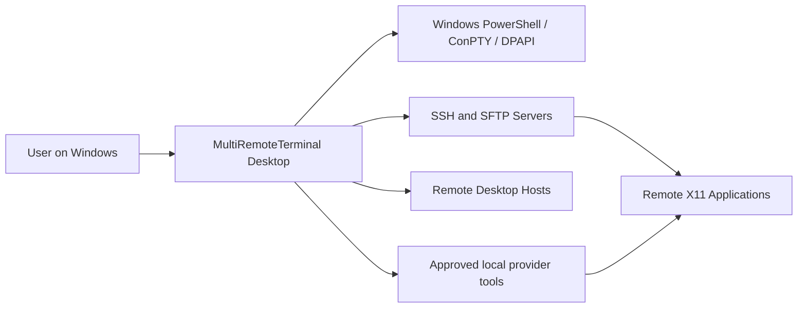
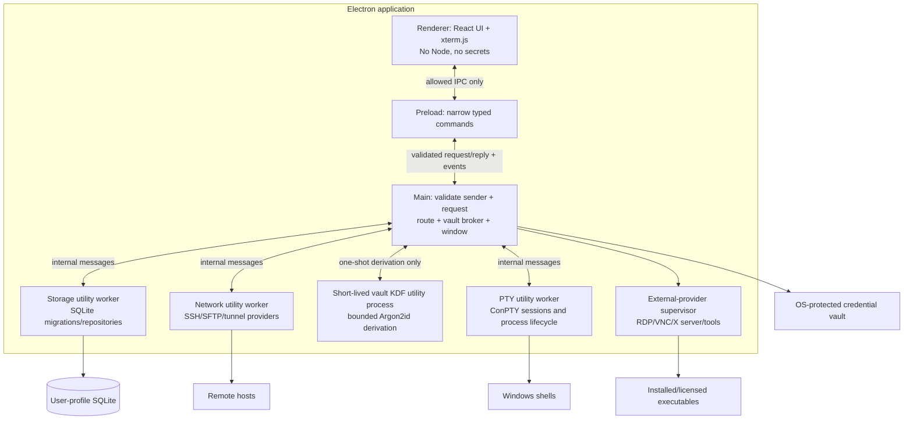
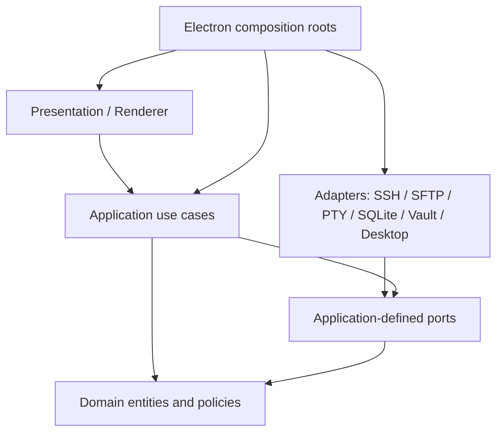
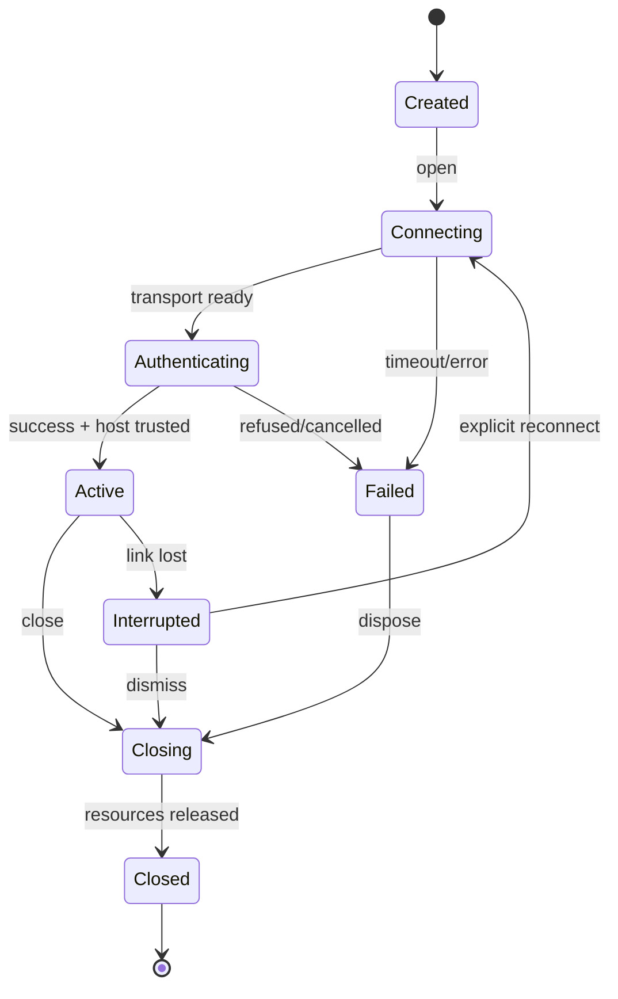

# MultiRemoteTerminal — Clean Architecture

**Architecture baseline:** ADR-0001; independent modular monolith, desktop only. All interfaces below are **design contracts**, not implementation source.

## 1. System context



## 2. Processes and trust



**Trust notes.** Utility workers isolate crashes and responsibility, but they still run privileged Node.js code and must **not** be treated as an OS security sandbox. Renderer content has no direct operating-system authority. Terminal output is **untrusted text** and is never rendered as privileged HTML. Remote hosts and third-party tools are untrusted peers. IPC sender IDs, origins and per-command permissions are validated by the main broker.

**Packaged path behavior (WP-07A).** The packaged Electron app lives under `resources/app.asar`; the composition root resolves its bundled worker entrypoints from `app.getAppPath()`. Utility workers use the physical `process.resourcesPath` as their working directory and receive the app root separately for module resolution. `credential-prompt.ps1` is copied to the resources directory. For the portable target, the user chooses the data location by placing the portable executable in a writable folder. The launcher provides `PORTABLE_EXECUTABLE_DIR` and `PORTABLE_EXECUTABLE_FILE`; before `ready`, main validates that both are absolute and refer to the same folder, creates `MultiRemoteTerminal-data/session-data` beside the portable executable, and sets Electron's `userData` and `sessionData` paths. Development and installed launches keep Electron's default profile paths. If portable storage cannot be prepared, main emits a static redacted failure event, shows an error, and stops. See [ADR-0014](adr/ADR-0014-wp07-portable-profile-location.md).

## 3. Dependency direction



- **Domain** is framework-free: connection definitions, session and tunnel rules, macro policies, provider capabilities, errors, value objects. Its only third-party runtime dependency is the pure JavaScript `re2js` policy engine used for bounded terminal highlight patterns; the import-boundary checker allowlists that exact package.
- **Application** coordinates one user intention per use case; owns state machine orchestration and transactions.
- **Ports** describe operations the application requires; no transport/library detail in interfaces.
- **Adapters** translate protocols and storage details; tested against port-level contract suites.
- **Presentation** owns layout, focus, accessibility, transient UI state. It does not know SQLite or ssh2 types.
- **Composition roots** construct concrete dependencies and negotiate availability of optional providers.
- The main process remains responsive while the synchronous Argon2id operation runs in a dedicated short-lived utility process. The process returns a derived key only to main, and never handles SSH connections or renderer requests.

Avoid a giant `SessionManager` with switch statements for each protocol. Use **capability discovery** and independent adapters while sharing lifecycle/use-case primitives.

## 4. Proposed repository layout (architecture map, not actual files)

```text
apps/desktop/
  src/main/             app boot, secure window, policy, IPC router, worker supervision
  src/preload/          typed allowlisted application bridge
  src/renderer/         shell chrome, tabs, terminal panes, sidebar, dialogs, status
  src/workers/          network, terminal, storage worker entrypoints
packages/
  domain/               entities, IDs, validation, lifecycle rules, error types
  application/          use cases, orchestration, ports, projections
  contracts/            IPC DTOs, event definitions and versioned validation schemas
  adapters/
    ssh/                SSH authentication, remote shell, host-key policy, forwarding
    sftp/               directory listings, transfers, remote file edit saves
    ftp/                explicit FTPS / consent-gated FTP directory browsing and transfers
    local-pty/          ConPTY backend
    persistence/        SQLite schema, migrations, repositories
    credential-vault/   Windows-protected secrets and master-password envelope
    desktop-providers/  RDP, VNC, X11, XDMCP, Mosh, serial, legacy tools
    daemons/            lifecycle and provider-specific control
  ui/                   design tokens and reusable accessible primitives
  test-support/         in-memory adapters, fake clocks, test SSH servers
docs/                   specs, decisions, REA evidence, compatibility
```

Directories may be simplified if the actual implementation does not justify separate packages, but **dependency rules remain**. Prefer a `pnpm` workspace with TypeScript project references; strict TypeScript and linted import boundaries.

## 5. Deep-module interface inventory

These are conceptual operations; Codex determines exact types and implementation.

| Port / module | Minimal interface operations | Invariants and implementation hiding |
|---|---|---|
| `SessionCatalog` | `save`, `list`, `get`, `delete`, `search` | Persist definitions only; never write runtime sockets or plaintext secrets |
| `ConnectionRuntime` | `open`, `write`, `resize`, `close`, `subscribe` | One stream owner per runtime ID; idempotent close; bounded byte buffers |
| `ProviderRegistry` | `available`, `capabilities`, `create` | One uniform discovery seam; unsupported capability is explicit, not silent |
| `HostTrustStore` | `verify`, `trustAfterApproval`, `revoke` | Reject unknown/changed keys by default; exact endpoint and key algorithm |
| `SecretVault` | `store`, `resolveForOperation`, `delete`, `lock`, `unlock` | Credential bytes never cross to renderer; distinguish unavailable vs locked |
| `TunnelController` | `start`, `stop`, `getStatus`, `subscribe` | Atomic startup; no daemonized orphan listeners; default loopback |
| `FileTransferController` | `list`, `queueCopy`, `cancel`, `watchProgress`, `openRemoteFile` | Temporary paths, collision policy, symlink policy, integrity before replace |
| `MacroRunner` | `validate`, `run`, `cancel` | Never record passwords; explicit target allowlist and approval for broadcast |
| `SshSessionLog` | `start`, `append`, `finish` | Per-session explicit consent; captures connection failures and terminal I/O; local native-selected path, bounded async writes, no credential-prompt secrets |
| `DaemonController` | `start`, `stop`, `status`, `readLogs` | No artificial timer; explicit bind, authorization and cleanup |
| `SettingsCatalog` | `get`, `update`, `exportRedacted`, `import` | Schema version, transactional changes, no secret export by default |

A port must document the success return, cancellation semantics, timeout, auth failure, state transition and resource ownership. Do not create port interfaces solely because classes exist; a port is justified by test substitution or independent integration.

The saved-folder bundle file-dialog port is an interactive OS operation: Windows open/save pickers settle only after explicit user selection or dismissal, and Electron exposes no abort signal or deadline for these methods. The renderer therefore waits without an IPC timeout while the modal picker is open. The native Cancel button dismisses it; a caller cancellation that arrives meanwhile is checked as soon as the picker settles, and no selected path is used for storage. Storage work starts only after that check and retains its own bounded worker timeout/cancellation. When a storage timeout or cancellation terminates the worker, its request settles only after worker exit and tracked temporary-file cleanup complete.

Workbench settings templates use the same native-picker and storage-worker boundary. The renderer submits only a validated current preference value for export; the main process supplies the path selected by the native picker. The storage worker validates and writes a versioned JSON file through a tracked sibling temporary path. Import validates the bounded file in the worker and returns preferences to the Settings dialog without saving them; the existing `preferences.save` command persists them only after the user chooses **Save changes**.

SSH session diagnostic logs use a separate per-session lifecycle. The user selects a `.log` destination through Electron's native Save dialog before the connection attempt; renderer requests carry only an opaque log handle, never a filesystem path. A supervised local writer receives bounded structured records for transport lifecycle, terminal input and output, then flushes and closes at terminal/app shutdown. It drops the recording and reports a local error if its queue or file cap is reached; it never stalls terminal transport. The file is plain text and can contain sensitive shell input/output and endpoint metadata, so recording requires explicit per-session consent and is never enabled by a saved preference. It does not capture SSH credential prompt values, key material, SFTP file contents, or tunnel payloads. See [ADR-0050](adr/ADR-0050-ssh-session-diagnostic-logs.md).

## 6. IPC contract (version 1)

All commands carry `{requestId, contractVersion, payload}`. All results carry `{requestId, ok, result|error}`. Event subscriptions include an owner/session ID and an explicit unsubscribe operation. Validate payload shape and sizes on the main side; reject unknown commands. IPC transport errors use stable codes and localized display text at the UI edge.

| Command family | Representative commands | Events |
|---|---|---|
| Sessions | `sessions.list`, `sessions.save`, `sessions.delete` | `sessions.changed` |
| Runtime | `runtime.open`, `runtime.input`, `runtime.resize`, `runtime.close` | `runtime.status`, `runtime.output`, `runtime.exit` |
| Files | `files.list`, `files.upload`, `files.download`, `files.cancel` | `files.progress`, `files.finished` |
| Tunnels | `tunnels.list`, `tunnels.save`, `tunnels.start`, `tunnels.stop` | `tunnels.status` |
| Macros | `macros.save`, `macros.run`, `macros.cancel` | `macros.step`, `macros.finished` |
| Credentials | `vault.lock`, `vault.unlock`, `vault.save` | `vault.state` |
| Integrations | `providers.capabilities`, `providers.launch` | `providers.status` |
| Settings | `settings.get`, `settings.patch` | `settings.changed` |

**Data size**: `runtime.output` should be binary streaming or short bounded chunks with delivery acknowledgements; never send megabyte-scale blobs as unbounded synchronous IPC. Throttle session events to avoid starving typing. UI supports 60 fps scroll under normal conditions, not a promised framerate for infinite output.

## 7. Runtime state and algorithms

### Session lifecycle



**Open:** validate definition -> resolve provider -> resolve credential in main only -> establish transport -> verify host key -> authenticate -> request PTY/shell -> allocate bounded stream -> emit active. On any error dispose partially-created resources in reverse order and emit a stable error. No automatic replay of user input on reconnect.

**Tunnel start:** validate host/ports and binding policy -> establish trusted/authenticated SSH transport -> attempt listener/remote-forward reservation -> mark ACTIVE **only after** successful bind -> forward bytes with backpressure and paired shutdown -> on stop unbind and close sockets. Remote/dynamic forwarding is opt-in; non-loopback listeners require explicit confirmation.

**Macro run:** use structured steps (`text`, `delay`, `waitForPattern`, `confirm`) rather than a script interpreter initially; validate step limits, target list and runtime readiness -> request explicit confirmation for multi-target broadcast -> enqueue a cancellable per-target run -> abort on a target failure according to configured stop policy; never auto-retry destructive steps. `waitForPattern` uses bounded output window and timeout.

**WP-06A macro library:** framework-free macro definitions use a versioned exact schema with ordered `send`, literal `waitForText`, bounded `delay` and `confirm` steps. The application catalog validates CRUD operations and delegates persistence through typed commands to the SQLite storage worker. The renderer reaches it only through preload IPC. The catalog has no count limit; each definition has bounded step count and text size. No credential or session fields are stored. Macro text is user-authored local database content and may contain sensitive text, so the editor warns users not to enter passwords, tokens or private-key content; it does not pattern-detect manually entered secrets.

**WP-06B1 macro recording:** an application-layer recorder owns one selected terminal's transient input and prompt-detection state. It stores only completed lines in memory, applies the macro step, line and total-text limits (reserving the macro name's text budget), omits clipboard paste and observes terminal output only transiently after stripping CSI, OSC, DCS, SOS, PM and APC control sequences in 7-bit and C1 forms. At recording start, it inspects only the target terminal's current xterm cursor line to detect a prompt that was already open. While paused, it keeps a bounded transient prompt line and latches recognized secret-prompt state until input is submitted or canceled with Ctrl+C; Resume while a recognized prompt remains open keeps recording paused and suppresses input. Recognized prompts, including repeated prompt names, suppress input and pause recording after submission. For recognizable full-screen redraws, a bounded row map follows common CSI cursor movement/erase controls and checks the cursor row so previous visible rows are not reprocessed as new prompts. Prompt matching and redraw classification are heuristic and cannot guarantee detection of arbitrary secrets or terminal redraw styles. No terminal output or transcript is persisted. Save errors report their code, target and retry/discard actions.

**WP-06B2 macro playback:** a framework-free application runner accepts one validated macro and one explicitly selected running local, SSH or Telnet terminal. It sends authored one-line input through the existing typed terminal commands, serializes one active run, reports step progress, waits for case-sensitive literal output in a 64 KiB transient text window with the authored bounded timeout, schedules bounded delays through an injected timer port, and pauses at each authored confirmation until the user continues. The output reader strips ANSI/control strings as chunks arrive and retains no terminal transcript after the run ends. Cancellation stops waits, delays and confirmations and prevents later steps. A terminal write already in flight is not retracted; the runner waits for its typed reply or the existing five-second renderer reply deadline. A timeout does not prove the underlying invocation was rejected, and playback does not retry it. Terminal failure, close or disconnect also stop the run. The renderer previews the exact saved steps and target before the explicit Run action and disables manual input to the selected terminal during playback. Playback does not reconnect, resume or rerun automatically.

**WP-06C MultiExec:** a framework-free application runner accepts one validated, non-empty, single-line input (maximum 4,096 characters) and two to 256 distinct, explicitly selected running local, SSH or Telnet terminals. Validation rejects control characters, Unicode line/paragraph separators and bidirectional formatting controls so the exact review remains visually stable. The renderer shows the exact text and every destination, then requires a separate final confirmation. The runner performs at most four writes concurrently through the existing typed terminal commands, keeps per-target status isolated, does not capture output or retry, and stops starting queued writes after cancellation while awaiting writes already in flight. TIMEOUT and UNAVAILABLE replies are reported as uncertain because the remote side may have received the input; other failures are scoped to that target. Renderer state blocks manual input to selected targets during review and send, and prevents overlap with macro recording or playback. Result status receives keyboard focus when the run starts and finishes. No target list, command text or result is persisted or logged. Windows E2E covers three distinct loopback SSH hosts; unit tests cover target validation, final approval, bounded sends, per-target failure, no retry, uncertain delivery and queued cancellation.

**WP-06E macro shortcuts:** shortcut assignments use a dedicated typed domain value, application catalog methods and allowlisted storage/preload commands. The renderer captures only Ctrl+Alt+Shift plus an allowlisted physical key, rejects AltGraph and unsupported modifiers, and opens the exact macro review for the current active local, SSH or Telnet terminal when it is running; otherwise it preselects the first running supported terminal, which the user can change before Run. The shortcut never starts playback; the existing explicit Run action remains required. Schema v3 adds the unique, cascading `macro_shortcuts` table without changing target preset semantics in `macro_bindings`. Windows E2E covers persistence, activation and the approval boundary.

**WP-06F remote macro playback:** the macro runner uses the existing typed terminal port for SSH and Telnet sessions; no protocol-specific playback path is added. Windows E2E exercises the real renderer, application runner, broker, utility worker and loopback peer. SSH uses first-use host trust and Telnet requires the visible plaintext acknowledgement. Both tests check the exact target and step review, no delivery before Run, one delivery after approval and completion from literal output. Public-server interoperability remains unverified.

A WP-06B2 wait step searches the sanitized 64 KiB output collected since playback started, including output from earlier steps in that run; it does not inspect terminal scrollback from before the run.

**SFTP upload/download:** resolve the user-selected destination and symlink policy -> offer overwrite/rename/skip -> stream through a sibling temporary path -> commit with the server/filesystem's no-replace operation unless overwrite was explicitly selected -> attempt bounded partial cleanup on cancellation. Treat path values as data, never shell-interpolate; see the implemented WP-05B boundaries below.

**WP-05A directory listing:** a trusted, running SSH session may open its SFTP subsystem on demand and list one remote directory. The application validates each remote path component at the IPC, application and worker boundaries, resolves the request through SFTP `realpath`, reads a bounded directory handle, caps output at 500 entries, and reports truncation. The renderer receives only validated names, metadata and normalized paths through the typed `ssh.files.list` command. Symlinks are identified and displayed without following them. Cancellation while opening the subsystem settles the caller promptly but retains a per-session busy guard and 15-second watchdog until the server callback arrives or the SSH session closes; a late channel is closed. If no callback arrives before the watchdog, the SSH transport closes so an unknown channel cannot remain unowned. A listing cancellation or timeout closes the active SFTP channel while preserving the shell when possible; only one SFTP operation may run per SSH session. The subsystem setup and listing budgets are 15 and 10 seconds; the worker host allows 30 seconds for the combined request and IPC margin, and the preload waits up to 35 seconds for the worker's bounded result. This slice does not implement transfers.

**WP-05B SFTP transfers:** upload and download commands carry only a session, operation ID, remote path and conflict policy through typed IPC; the main process selects local paths through native dialogs, and those paths are sent only to the SSH utility worker. Transfers reuse the already trusted SSH client and its SFTP subsystem, are serialized one per session, stream with backpressure, publish typed progress at most every 100 ms plus the final byte count, and use a 30-second idle timeout plus a one-hour overall request deadline. Upload sources are opened in the worker and checked against their path identity and byte count before commit. Before remote I/O and again before commit, the worker compares server `realpath` with the normalized requested path and `lstat`s the final object to reject known symlink ancestors. Remote uploads use random exclusive sibling `.partial` files; the SFTP v3 rename operation commits the temp file, relying on the protocol rule that an existing destination is an error. Explicit overwrite temporarily moves the existing file to a random sibling backup, compares its available metadata identity, replaces it, and restores the backup if replacement fails when safe to do so. Downloads check remote source identity around streaming and require the advertised byte count when available before completing the staged local target. Downloads use a random local sibling temp file and a no-replace hard-link commit for new or renamed destinations; overwrite verifies the selected target identity before replacing it. The local overwrite rename has a small check-to-rename race because Windows provides no identity-conditional rename. Since SFTP v3 is path-based, a hostile remote peer can still race a path-component swap between a check and its use. A progress transition into `committing` disables cancellation; a delayed commit event extends any existing cancellation cleanup grace, while other pre-commit cancellation and worker deadlines attempt stream/temp cleanup. Forced worker termination or connection loss can leave partial data. The Windows loopback SFTP fixture verifies upload and download bytes across the UI, broker, worker and filesystem. Later Windows acceptance adds standalone SFTP ([WP-05C](results/WP-05C-sftp-only-sessions-2026-10-24.md)), a simulated native file drop ([WP-05E](results/WP-05E-sftp-file-drop-2026-10-26.md)), representative 100 MiB transfers ([WP-05F](results/WP-05F-large-file-acceptance-2026-10-26.md) and [WP-05G](results/WP-05G-sftp-large-upload-2026-10-26.md)), and narrow interrupted SFTP download cleanup/retry ([WP-05H](results/WP-05H-sftp-download-recovery-2026-10-26.md)), and interrupted SFTP upload cleanup plus explicit same-route reconnect/retry while the worker remains alive ([WP-05K](results/WP-05K-sftp-upload-recovery-2026-10-26.md)). WP-05L.1 preserves FTP upload artifacts after cancellation, failure or late conflict because path-only deletion cannot prove object identity; corrected FTP regression and recovery E2E passed the Phase 04 code gate; broader acceptance remains open. Actual Explorer drag gestures, sustained throughput, worker-termination/restart residue and broad SFTP server interoperability remain open. See [ADR-0007](adr/ADR-0007-sftp-transfer-commit.md).

**WP-05C standalone SFTP:** `sftp.open` and `sftp.close` are fixed typed IPC commands into the SSH application controller; the ordinary first-use host-trust decision and native credential prompt are reused. The SSH worker authenticates the endpoint, then returns from its `ready` callback without requesting a PTY or shell. The resulting files-only runtime can use the existing `ssh.files.*` list/transfer operations; terminal input, output acknowledgement and resize are rejected for this mode. It shares the SSH transport lifetime and supervised worker cleanup, while the renderer presents a files tab without a terminal surface. Saved profiles are credential-free; SQLite persists them in the existing `ssh` row form with the strict `options_json` marker `sftpOnly: true`, which decodes to the domain-level `sftp` kind. Saved-folder bundle format v3 includes SFTP metadata while retaining v1/v2 import validation. The Windows loopback acceptance test exercises first-use host trust, authenticated listing and download bytes, save/reopen and verifies no shell request; see [ADR-0008](adr/ADR-0008-sftp-only-sessions.md). Actual Explorer drag/drop, sustained throughput and broader SFTP server compatibility remain unverified; WP-05L.1 preserves FTP upload artifacts after cancellation, failure or late conflict because path-only deletion cannot prove object identity; corrected FTP regression and recovery E2E passed the Phase 04 code gate; broader acceptance remains open. WP-05K covers interrupted SFTP upload stage cleanup and explicit retry only while the worker remains alive and the same trusted route reconnects. WP-05H and WP-05I verify interrupted SFTP and FTP download-side staging cleanup with explicit retry; see [WP-05H evidence](results/WP-05H-sftp-download-recovery-2026-10-26.md) and [WP-05I evidence](results/WP-05I-ftp-download-recovery-2026-10-26.md).

**WP-05J contextual-pane preference:** `showSftpBrowserBesideSsh` is part of the validated workbench-preferences value and is persisted by the existing SQLite settings repository. The Settings dialog submits it through the normal typed preference command; the renderer applies the saved value immediately. It controls only whether the contextual SFTP pane is visible beside a running SSH terminal. Turning it off hides the mounted pane and gives the terminal the full layout; keeping the component mounted avoids cancelling an in-progress transfer, and its inactive state stops accepting file drops. Standalone SFTP/FTP files-only tabs keep their files view. Schema v5 migrates older preference records with the contextual pane enabled by default, preserving existing behavior.

**WP-05E remote-file drag/drop:** Only the active SFTP/FTP browser folder is marked as a drop target. A sandboxed preload capture listener accepts native trusted file drops and resolves each `File` with Electron `webUtils.getPathForFile`; it never returns that path to renderer code. A dedicated typed IPC channel validates the owning main frame, transport, session, current remote directory, batch size and path shape. Main stores regular file paths in a bounded registry behind one-use UUIDs bound to the sender and exact transfer destination, with a 10-minute expiry and renderer-destruction cleanup. Upload commands carry the opaque UUID and reuse the existing explicit conflict choice, worker staging, progress, cancellation and refresh. The renderer receives only token/name/size metadata and processes at most 16 files serially; its listener acknowledges only events matching the active pane's session, protocol and folder. Preload discards a successful registration when no live listener accepts it, including when a pane unmounts or changes folders while path validation is pending. The pane discards unused handles after queue completion, rejected busy batches and teardown. Main applies the same sender/session/transport/directory binding to handle discard as to consumption. The keyboard-accessible Upload file button remains available. The Windows loopback E2E uses an E2E-only preload hook to supply a native-backed file through the same resolver/registration/upload flow; actual Explorer drag gesture automation remains unverified. See [ADR-0025](adr/ADR-0025-preload-file-drops.md).

**WP-04A loopback local SSH forwarding:** a persisted definition references a saved SSH profile and contains a label, bind port and remote target. Explicit start opens a separate files-only SSH runtime through the existing host-trust and credential flow; it requests no PTY, shell or SFTP subsystem. The SSH worker owns the loopback listener and forwarded channels. The controller reports active only after bind success and closes the listener and SSH runtime together. Listener sockets preserve TCP half-close behavior. Definitions do not auto-start and runtime status is not persisted. This first slice binds only to `127.0.0.1`; port `0` permits OS assignment. Later WP-04 slices add loopback-requested remote and dynamic forwarding, plus SSH gateway routes. Public bind controls and consent remain open. See [ADR-0009](adr/ADR-0009-wp04a-local-ssh-forwarding.md).

**WP-04B loopback remote SSH forwarding:** the shared tunnel model persists local and remote direction. An explicit start opens a dedicated files-only SSH runtime and requests a remote `127.0.0.1` bind with `forwardIn`; port `0` is replaced by the server-assigned port only after bind confirmation. The SSH utility worker accepts matching forwarded channels, connects each to the configured local destination, and bridges the streams with a 64-connection bound and 15-second channel-open timeout. Stop calls `unforwardIn` with a 1.5-second bound, closes paired sockets/channels and closes the SSH runtime. Shutdown tears down the transport so any unacknowledged server bind also ends with the connection. Server policy, including `GatewayPorts`, may broaden the actual bind; the manager warns about this before start. Non-loopback bind controls and consent remain open; dynamic forwarding is covered by WP-04C and gateway routes are covered by WP-04D-G. See [ADR-0010](adr/ADR-0010-wp04b-remote-ssh-forwarding.md).

**WP-04C dynamic SSH SOCKS5 forwarding:** a persisted destination-free definition starts an explicit loopback-only SOCKS5 listener over a files-only SSH runtime. The SSH worker supports no-authentication TCP `CONNECT` to IPv4, domain-name and IPv6 destinations; domain resolution occurs on the SSH server. Pending/open clients are bounded to 64, channel setup to 15 seconds, and stop closes the listener, sockets and channels. Authentication methods, `BIND`, `UDP ASSOCIATE` and broad interoperability remain open. Gateway routing for terminal, SFTP and tunnel definitions is covered by WP-04D-G. See [ADR-0011](adr/ADR-0011-wp04c-dynamic-socks-forwarding.md).

**WP-04D SSH gateway routes:** the initial implementation opened a saved SSH target through up to two selected saved SSH gateway profiles. The route is selected per connection and is not persisted with the target or exported in saved-folder bundles. The renderer sends profile IDs only; the main broker resolves and validates SSH definitions before calling the SSH controller. The application requests credentials separately in route order with gateway/destination labels. The supervised SSH worker opens each hop over the prior client's `forwardOut` channel, verifies each endpoint's host key independently, and requests a shell only from the final destination. A 15-second deadline bounds each inter-hop channel open and the existing 130-second overall open deadline bounds the chain. On failure, close or shutdown, every channel and client is torn down. Windows E2E covers one and two gateways, independent first-use trust for each endpoint, terminal output and cleanup. WP-04E extends the route to SFTP-only targets, WP-04F adds gateway-routed saved tunnels, WP-04G verifies routed remote-forward and dynamic SOCKS TCP roundtrips, and WP-04H raises the current cap to three gateways. Longer routes and public-server interoperability remain open. See [ADR-0012](adr/ADR-0012-wp04d-ssh-gateway-routes.md), [ADR-0032](adr/ADR-0032-sftp-only-ssh-gateway-routes.md), [ADR-0033](adr/ADR-0033-wp04f-tunnels-through-ssh-gateways.md), [ADR-0034](adr/ADR-0034-wp04h-three-gateway-routes.md) and [WP-04H results](results/WP-04H-three-gateway-routes-2026-10-26.md).

**WP-04E SFTP-only SSH gateway routes:** a saved SFTP target uses the same per-connection gateway selection. At this phase the route allowed up to two gateways; WP-04H raises the current cap to three. The renderer sends only profile IDs; main resolves SSH definitions and rejects missing, non-SSH, duplicate or endpoint-repeating hops before credentials are requested. The existing SSH controller and supervised worker establish and verify each SSH endpoint through nested `forwardOut` channels, then request only the destination's SFTP subsystem. No PTY or shell is requested. Credential and host-trust prompts remain ordered by route; timeout, cancellation, failure and close dispose of the full chain. Windows Electron E2E verifies two gateway relays, trust for the new SFTP endpoint, remote listing, absence of a shell request and cleanup; WP-04H covers three gateways. The route is not persisted or exported with the target. WP-04F adds gateway-routed saved tunnels and WP-04G verifies routed remote-forward and dynamic SOCKS TCP roundtrips. Routes longer than three gateways and public-server interoperability remain open. See [ADR-0032](adr/ADR-0032-sftp-only-ssh-gateway-routes.md), [ADR-0034](adr/ADR-0034-wp04h-three-gateway-routes.md) and [WP-04H results](results/WP-04H-three-gateway-routes-2026-10-26.md).

**WP-04F saved tunnels through SSH gateways:** any saved local, remote or dynamic tunnel may be explicitly started directly or through selected saved SSH gateway profiles. At this phase the route allowed up to two gateways; WP-04H raises the current cap to three. Gateway selections are per-start and do not change the persisted tunnel definition. The renderer sends IDs; main resolves SSH profiles and checks route endpoint overlap against the tunnel target before calling the application controller. The controller opens its existing files-only SSH runtime through the selected route, then starts the tunnel in that same supervised worker. No PTY, shell or SFTP subsystem is requested. Same-route concurrent starts coalesce; a different route for the same starting tunnel is rejected as busy. The existing host trust, 15-second inter-hop channel bound, 130-second connection-open bound, forwarding limits and worker cleanup remain in force. Gateway routes do not change local/remote bind policy. WP-04G's Windows E2E verifies routed local, remote and dynamic TCP traffic through two gateways; WP-04H extends those loopback routes to three. Routes longer than three hops and broader server interoperability remain open. See [ADR-0033](adr/ADR-0033-wp04f-tunnels-through-ssh-gateways.md), [ADR-0034](adr/ADR-0034-wp04h-three-gateway-routes.md) and [WP-04H results](results/WP-04H-three-gateway-routes-2026-10-26.md).

**WP-04H bounded three-gateway SSH routes:** saved SSH terminal, SFTP-only and local/remote/dynamic tunnel flows accept zero to three ordered saved gateways. A shared renderer picker enforces the same domain limit and excludes selected or target-equivalent endpoints. Main resolves profile IDs into canonical SSH endpoints; routes and credentials remain operation-scoped and are absent from persistence and exports. Host trust is checked independently and credentials are requested in route order. The worker protocol remains version 1 and rejects more than three hops. Terminal routes request a shell only at the target; SFTP routes request only SFTP there; tunnel routes remain files-only. Existing 15-second per-hop and 130-second overall bounds and full chain cleanup apply. For terminal and SFTP routes, the destination can use the existing password, private-key or agent authentication selection; gateway hops use their own password prompts. Tunnel routes use the saved SSH credentials. Agent auth remains on the destination worker connection with agent forwarding disabled. Windows loopback E2E exercises three-gateway terminal and SFTP routes and local, remote and dynamic tunnel roundtrips, including trust, subsystem policy, exact relayed traffic and cleanup. WP-04I additionally verifies mock-agent signing at terminal and SFTP destinations through three gateways. Routes beyond three hops and broad public-server interoperability remain open. See [ADR-0034](adr/ADR-0034-wp04h-three-gateway-routes.md), [WP-04H results](results/WP-04H-three-gateway-routes-2026-10-26.md) and [WP-04I results](results/WP-04I-routed-ssh-agent-auth-2026-10-27.md).

**WP-09B Telnet terminal:** the UI requires a fresh, visible plaintext warning acknowledgement for each connection, including each saved-profile reopen. The profile stores only the canonical host and port; login data is typed into the remote terminal and is not intercepted or persisted. Typed `telnet.*` IPC crosses the preload and main broker into a supervised Electron utility worker; the worker owns the TCP socket and protocol codec. The codec incrementally parses Telnet IAC commands, bounds subnegotiation payloads to 512 bytes, handles NVT line endings until BINARY is accepted, and supports BINARY, Suppress Go Ahead, remote ECHO, NAWS and fixed `XTERM-256COLOR` terminal type. Terminal output is UTF-8 decoded, sequence-acknowledged and backpressured; input queues are bounded. TCP connection establishment is limited to 12 seconds, the worker open request to 15 seconds, and the preload IPC wait to 20 seconds. Close, timeout, worker crash and application shutdown destroy the socket and settle pending operations. Telnet carries terminal bytes without encryption and must not be used for secrets or untrusted networks. Windows loopback E2E exercises the UI, warning, TCP negotiation, terminal input/output, catalog save and consent-gated reopen; this does not claim interoperability against every historical Telnet server.

**WP-09C FTP/FTPS browser and WP-09D transfers:** FTP endpoints are credential-free saved definitions; the `secure` option selects explicit FTPS, which is the connect-dialog default. FTP usernames/passwords come from the separate Windows credential prompt and are sent only to a dedicated utility worker. The `basic-ftp` client is serialized per connection, uses a 30-second server-progress timeout, caps parsed directory data at 2 MiB and results at 500 entries, suppresses protocol logging, and refuses PASV transfer hosts that differ from the control host. Every plaintext FTP connection needs a short-lived, one-use trusted submit gesture bound to the visible host and port and independently consumed by the main broker. Paths and replies are validated at the domain, IPC and worker boundaries. The renderer requests upload or download using only a session and remote path; main obtains local paths through native dialogs, and those paths cross only the private worker protocol. One transfer per FTP session streams through the supervised worker and publishes typed progress, including the finalizing phase. Non-overwrite uploads use standard argumentless `STOU` in the requested directory; the worker temporarily changes CWD, validates the server-reported unique path, then restores the prior directory. The server chooses the uploaded filename, and the in-progress file is visible to other listing clients. On cancellation the worker ends the local upload stream and preserves the server path for user review; it does not issue path-only `DELE` while connected or after reconnect because FTP cannot prove object identity. If STOU is rejected, upload fails closed. Explicit overwrite stages a random sibling and uses a backup/replace sequence where the server permits it; this is not atomic on all servers. Downloads use a sibling local temporary file and a no-replace commit, with explicit overwrite/rename/skip/cancel handling. A committing phase blocks cancellation. At the one-hour request deadline, an active commit gets a bounded two-minute settlement window for the FTP command sequence and rollback; if still stuck, forced termination can leave `.backup` and `.partial` recovery files. Other timed-out operations get a two-second cleanup grace. Windows loopback E2E verifies standard argumentless STOU, selected-directory CWD/restore, upload, download, the renderer-to-worker flow and profile persistence/reconnect. WP-05I also verifies local staging cleanup and explicit reconnect/retry after an interrupted FTP download. WP-05L.1 removes the in-memory reconnect registry and all automatic path-only FTP `DELE`. Cancellation, transfer failure or late conflict can leave an upload artifact for user review; successful explicit overwrite preserves the previous file under a generated backup name. Worker termination can also leave residue, and the app has no dedicated FTP leftover-cleanup workflow. See [ADR-0058](adr/ADR-0058-ftp-interrupted-upload-preservation.md). Public FTPS CA-chain interoperability, worker-termination residue and broader FTP acceptance remain open; see [WP-05I evidence](results/WP-05I-ftp-download-recovery-2026-10-26.md) , [WP-05L.1 safety result](results/WP-05L1-ftp-upload-recovery-safety-2026-10-30.md), and [WP-05L historical evidence](results/WP-05L-ftp-upload-recovery-2026-10-26.md). See [ADR-0006](adr/ADR-0006-ftp-no-clobber-uploads.md) for the unique-store decision and its limitations.

**WP-08C remote text editing:** an explicit Edit action on a regular SFTP file invokes typed `ssh.files.read-text` or `ssh.files.write-text` commands through the preload and main broker. The renderer receives file contents only after that user action. The domain caps UTF-8 content at 512 KiB and rejects NUL and malformed surrogate sequences; the SSH utility worker accepts strict UTF-8 reads only and hashes the loaded bytes with SHA-256. Save stages a unique sibling, re-reads and checks both loaded revision and available remote identity before crossing the commit boundary, then backs up and replaces the source with rollback attempts. One SFTP operation runs per session, reports typed progress, and supports cancellation before commit. The editor has explicit Save, Reload and Close actions, warns before discarding a draft, and retains the draft after a conflict. Syntax profiles, keyword highlighting, autosave and a local editor are not part of this slice. See [ADR-0017](adr/ADR-0017-remote-text-editing.md).

**WP-08D local text editing:** the renderer can request the native file picker but cannot send or receive paths. Main retains one selected absolute path behind an opaque UUID and sends file operations to a one-shot Electron utility worker. The worker accepts regular files only, reads strict UTF-8 up to 512 KiB, checks SHA-256 revisions and identity, and stages a no-replace sibling save with backup rollback. The UI requires explicit Save, Reload and Close, preserves drafts on conflict and preserves the first observed line-ending style; mixed endings are normalized to that style with an accessible disclosure. Selection paths are cleared on close/shutdown and are not persisted. Forced worker termination during replacement can leave a `.partial` or `.backup` file; same-directory hard-link support and Windows ACL preservation remain platform limitations to verify. Windows UI acceptance verifies native picker cancellation and selection; syntax-profile E2Es still use the guarded path hook. See [ADR-0022](adr/ADR-0022-local-text-editing.md).

**WP-08E/WP-08F/WP-08G/WP-08H/WP-08I/WP-08J/WP-08K/WP-08L/WP-08M/WP-08N/WP-08P/WP-08Q/WP-08R editor syntax profiles:** the pure domain module exposes profile resolution and bounded lexical token ranges for Markdown, Shell, PowerShell, Python, JavaScript/TypeScript, PostgreSQL-oriented SQL, TOML, YAML, INI, XML, HTML, dotenv, Java Properties and JSON source text. Auto selection uses recognized basename patterns; the renderer lets the user override with Plain, Markdown, Shell, PowerShell, Python, JavaScript/TypeScript, SQL, TOML, YAML, INI, XML, HTML, Environment file, Java Properties or JSON for that file. A shared editor-content module keeps the textarea as the accessible input and overlays aria-hidden token spans, synchronizing both scroll axes. Tokenization is capped at 64,000 UTF-16 code units and 4,096 tokens per render; the rest remains plain and editable. The Markdown profile colors common CommonMark-style headings, lists, block quotes, thematic breaks, fenced and inline code, emphasis, direct links and same-line HTML comments. Each inline lookahead is limited to 512 code units and aggregate lookahead work to 256,000 probe steps per preview; exhaustion displays the existing truncation notice. It does not render Markdown or model container-block nesting. The SQL profile recognizes a bounded PostgreSQL-oriented lexical subset: common keywords, types, known function calls, literals, comments, operators, quoted identifiers and positional parameters. Dollar-quote tags are limited to the default 63-character identifier size. The TOML profile colors bare and quoted keys, its four string forms, common numeric and date/time values, booleans and special floats, comments outside strings, and table/array punctuation. Bare-key scanning is ASCII-oriented. The YAML profile colors common quoted/plain keys, YAML 1.2 core scalar forms, separated comments, flow punctuation, document markers/directives, tags, anchors, aliases and block scalar text. Implicit-key lookahead is capped at 1,024 UTF-16 code units and block scalar indentation is a bounded lexical approximation. The INI-style profile colors bounded `.ini`/`.cfg` section headers, keys, `=`/`:` separators, closed single- or double-quoted values, common decimal/exponent numbers, common yes/no boolean literals and full-line `;`/`#` comments. Inline comments, multiline/continued values, quoted keys and dialect validation are outside the lexical subset. XML colors ASCII-oriented element/attribute names, quoted values, opaque comments/CDATA/declarations and bounded text entity references without resolving them. The dotenv subset colors ASCII environment keys, optional export, assignment separators, closed quoted or unquoted values, full-line comments and whitespace-separated inline comments; it does not expand variables, interpret escapes or support multiline values. The Java Properties subset colors leading #/! comments, keys through the first unescaped =, : or space/tab/form-feed separator, separators and raw values; continued logical entries remain plain and escapes are not decoded. The HTML profile colors common tags, attributes, comments, declarations and text entities for `.html`/`.htm` files; raw-text element contents remain opaque, including conditional `noscript` content. These modules do not execute, validate or persist source text. They are syntax color aids, not full language parsers or terminal shell integration. See [ADR-0023](adr/ADR-0023-text-syntax-profiles.md), [ADR-0037](adr/ADR-0037-powershell-text-syntax-profile.md), [ADR-0038](adr/ADR-0038-python-text-syntax-profile.md), [ADR-0039](adr/ADR-0039-javascript-typescript-text-syntax-profile.md), [ADR-0040](adr/ADR-0040-sql-text-syntax-profile.md), [ADR-0041](adr/ADR-0041-toml-text-syntax-profile.md), [ADR-0042](adr/ADR-0042-yaml-text-syntax-profile.md), [ADR-0043](adr/ADR-0043-markdown-text-syntax-profile.md) and [ADR-0052](adr/ADR-0052-ini-text-syntax-profile.md), [ADR-0053](adr/ADR-0053-xml-text-syntax-profile.md), [ADR-0055](adr/ADR-0055-dotenv-text-syntax-profile.md), [ADR-0056](adr/ADR-0056-java-properties-text-syntax-profile.md), [ADR-0057](adr/ADR-0057-html-text-syntax-profile.md), [WP-08P results](results/WP-08P-dotenv-syntax-profile-2026-10-28.md), [WP-08Q results](results/WP-08Q-java-properties-syntax-profile-2026-10-28.md) and [WP-08R results](results/WP-08R-html-syntax-profile-2026-10-30.md).

**WP-01F terminal keyword highlighting:** the renderer reads text only from xterm's parsed normal buffer and visible rows, matches bounded user rules with `re2js`, then applies transient foreground decorations to matching cells. It never rewrites terminal input/output, ANSI sequences or persisted scrollback. Cell extraction stops before assembling lines over 2,048 UTF-16 code units; rules are capped by count, source length, RE2 program size and group count; scanned rows and match counts are also bounded. Decorations refresh after parsing, scrolling, buffer changes and terminal resize. Workbench preferences migrate from schema v1 to v2, retaining the greeting and defaulting highlights off with no rules. The application CSP allows runtime inline styles needed by xterm's ANSI palette and decoration stylesheet while keeping scripts self-only and network sources denied. This offers configurable keyword coloring, not a shell parser or full zsh syntax highlighting. See [ADR-0018](adr/ADR-0018-terminal-keyword-highlighting.md).

**WP-01G/WP-01H/WP-01I terminal shell prompt coloring:** the renderer uses the shared pure Shell tokenizer to color active normal-buffer input after an explicit user keystroke when the visible prompt ends in `$`, `#`, `%`, `>`, `❯` or `➜`. It records a transient xterm marker and cursor column, decorates at most 64 token spans per refresh, and clears the anchor on submission/cancel/clear, failed paste, when disabled or on pane teardown. WP-01H carries that anchor only across consecutive rows marked `isWrapped`, reconstructs input within 2,048 UTF-16 code units and 128 rows, and splits token decorations at physical row boundaries. Beyond 128 rows it suppresses overlays and retains the anchor only while the cursor row remains wrapped; when the cursor returns within the limit it validates the full chain before restoring colors. WP-01I gives common Bash/Zsh builtins a separate color and follows fixed command-position rules through selected wrappers and their known option arguments. Neither tokenizer nor renderer queries a shell, resolves PATH, alters input/output, runs a command, or persists command text. Workbench preference schema v4 adds the opt-in toggle and migrates schemas v1-v3 with coloring disabled. Local, SSH and Telnet terminal panes share the feature; Windows E2E covers Git Bash prompt coloring and physical wraps over SSH/Telnet. Git Bash Readline horizontally scrolls long input. Serial is excluded; aliases, functions, shell-specific grammar, quoted and other continuation forms, and broad interoperability remain unsupported. See [ADR-0024](adr/ADR-0024-terminal-shell-prompt-coloring.md), [ADR-0036](adr/ADR-0036-terminal-wrapped-shell-input-coloring.md) and [ADR-0044](adr/ADR-0044-shell-command-grammar-coloring.md).

**WP-01J explicit Shell line continuation coloring (partial):** when input ends in an unquoted odd backslash and the next visible prompt ends in `>`, the renderer passes a bounded pure lexical state to the shared tokenizer for the continuation row. The per-terminal state contains only command-position, selected-wrapper, option-value and test-expression flags; it contains no submitted command text. State is cleared after a noncontinued submission, including Enter on an empty continuation prompt, Ctrl+C/Ctrl+D/Ctrl+L, failed input, disabling syntax colors or pane teardown. Prompt detection uses a visible `>` suffix heuristic and cannot distinguish a custom primary prompt with the same ending. The existing normal-buffer, 2,048-code-unit/128-row/64-decoration bounds still apply. Quoted backslash continuations, open quotes, multiline substitutions, compound-block continuation and custom secondary prompts remain unsupported.

**WP-01K/WP-01L/WP-01M/WP-01N PowerShell terminal prompt coloring (partial):** The opt-in renderer preference recognizes the common `PS <path>>` prompt and routes active input through the pure, bounded PowerShell tokenizer shared with local/SFTP editors. After an unquoted odd trailing backtick or a recognized trailing pipeline, binary, assignment, logical or array-separator operator, the tokenizer carries command-position flags to an exact `>>` continuation prompt. For balanced open delimiters nested up to 32 levels, it additionally carries only expected closing characters. It does this only when the caret is at an unambiguous logical input end. If xterm's cursor is on an occupied final cell while delayed wrapping is pending, the public buffer API cannot identify which side of that cell the caret occupies, so coloring fails closed. The same 2,048-code-unit, 128-row and 64-decoration limits and transient xterm marker lifecycle apply. Enter, cancellation, failed input, disabling the setting, a mismatching prompt and pane teardown clear state/decorations; command text is not retained, logged, persisted or sent for highlighting. Prompt recognition is shape-based, so custom prompts matching either form are indistinguishable; quoted backticks, incomplete strings or block comments, mismatched or over-depth delimiters, other natural continuation forms, other prompt shapes and full PowerShell grammar remain unsupported. The feature does not parse or execute input. See [ADR-0046](adr/ADR-0046-powershell-terminal-prompt-coloring.md), [ADR-0047](adr/ADR-0047-powershell-backtick-continuation-coloring.md), [ADR-0048](adr/ADR-0048-powershell-natural-continuation-coloring.md) and [ADR-0049](adr/ADR-0049-powershell-open-delimiter-continuation-coloring.md).
**WP-09E Windows serial/COM:** the renderer uses only typed `serial.*` commands through preload and the main broker. The main process starts the serial utility worker on the first explicit port-list or open action; the worker loads the native addon and owns the bindings and port streams. Configuration accepts canonical `COM1`–`COM4095`, bounded baud, data bits, parity, stop bits and flow control. Port metadata is normalized, capped and excludes serial numbers. Input is UTF-8 text limited to 1,024 characters per command and bounded in-flight data; writes use a baud-aware deadline capped at two minutes. Output is decoded as UTF-8, chunked, sequence-acknowledged, bounded and backpressured. Resize changes only the local terminal viewport. Open, action, close and shutdown have worker deadlines and cleanup; worker crashes invalidate sessions. A mock-backed Windows E2E verifies native binding loading and the UI-to-worker read/write route without opening physical devices. A provider/controller regression injects a binding-level read error after open and verifies retryable failure plus a later explicit reconnect. Physical unplug timing, device-specific error sequencing, hardware interoperability and driver signature validation remain open. See [ADR-0019](adr/ADR-0019-wp09e-serial-provider.md).

**WP-09E.1 serial saved profiles:** a saved definition carries the validated COM path and full port settings as non-secret metadata. The SQLite adapter stores that configuration in the existing `options_json` field with no network host, port, or credential reference. Opening a profile re-lists current ports, preserves the saved path if it is absent, and requires an explicit Connect action; it never substitutes another listed device silently. Folder bundle version 6 exports/imports serial profiles while continuing to accept versions 1–5 with their prior protocol limits. Windows E2E covers save, export, import into another user-data profile, app restart and mock-port reconnect. Physical-device, hot-unplug and driver-signature checks remain open.

**WP-09F explicit FTPS acceptance:** A Windows loopback E2E verifies the normal certificate rejection path and a successful connection when the test CA is explicitly supplied through an un-packaged E2E flag. The test CA is passed only to the FTP utility worker and added as a per-connection `basic-ftp` TLS `ca` option; production FTP worker environments continue to exclude arbitrary parent environment variables and use Node's normal certificate validation. The fixture confirms encrypted control commands and TLS-protected listing and upload data channels. WP-09G verifies TLS data-channel session reuse against the loopback fixture; public CA-chain and broader server compatibility remain open.

## 8. SQLite logical schema (v3)

Use `TEXT` UUIDs for IDs, UTC ISO-8601 timestamps, foreign keys enabled, unique constraints, WAL mode, transactional migrations. Database file stored in per-user `app.getPath('userData')`. Database has no secret plaintext; `credential_ref` points to the vault. The selected built-in `node:sqlite` driver runs only in the storage utility process; see [ADR-0005](adr/ADR-0005-node-sqlite-storage-worker.md) and the [WP-03 runtime review](dependencies/WP-03.md).

| Table | Fields (type; required where noted) | Important rules |
|---|---|---|
| `folders` | `id TEXT PK`, `parent_id TEXT FK?`, `name TEXT NOT NULL`, `sort_order INTEGER` | Detect and reject cycles; cascade policy on folder deletion asks user |
| `session_definitions` | `id TEXT PK`, `folder_id TEXT FK?`, `kind TEXT`, `name TEXT`, `host TEXT?`, `port INTEGER?`, `username TEXT?`, `credential_ref TEXT?`, `options_json TEXT`, `options_version INTEGER`, `favorite INTEGER`, `created_at TEXT`, `updated_at TEXT` | `kind` enum: `local`, `ssh`, `telnet`, `rlogin`, `mosh`, `rdp`, `vnc`, `serial`, `ftp`, `xdmcp`; validate ports 1..65535 for network transports; no runtime details. Telnet, FTP, and RDP records contain only their canonical endpoint and protocol options; none stores account credentials. |
| `session_tags` | `session_id TEXT FK`, `tag TEXT`, composite PK | Search and classification |
| `tunnel_definitions` | `id TEXT PK`, `session_id TEXT FK`, `name TEXT`, `mode TEXT`, `bind_host TEXT`, `bind_port INTEGER`, `target_host TEXT?`, `target_port INTEGER?`, `enabled INTEGER`, `created_at TEXT` | `mode=local/remote/dynamic`; no limit on records; binding validated at start; definitions are independent of live sockets |
| `macro_definitions` | `id TEXT PK`, `name TEXT`, `description TEXT?`, `steps_json TEXT`, `schema_version INTEGER`, `created_at TEXT`, `updated_at TEXT` | Steps versioned and validated; no credential fields or target bindings; user-authored text can still contain sensitive data and must not include secrets |
| `macro_bindings` | `macro_id TEXT FK`, `session_id TEXT FK`, composite PK | Target presets; confirm multi-target execution |
| `macro_shortcuts` | `macro_id TEXT PK FK`, `code TEXT UNIQUE NOT NULL` | One app-wide shortcut per macro; macro deletion cascades; only allowlisted physical codes are stored |
| `ssh_host_keys` | `id TEXT PK`, `canonical_host TEXT`, `port INTEGER`, `key_algorithm TEXT`, `public_key_base64 TEXT`, `sha256_fingerprint TEXT`, `trusted_at TEXT`, `source TEXT` | One key per canonical host+port; mismatches block until explicit reset; host aliases policy defined |
| `settings` | `key TEXT PK`, `value_json TEXT`, `schema_version INTEGER`, `updated_at TEXT` | Per-key exact schema validation. Current key `workbench` v11 stores the bounded plain-text `startupGreeting`, opt-in terminal highlights and up to eight bounded RE2JS rules, opt-in `autoSaveSessions`, opt-in `terminalShellSyntaxEnabled`, `showSftpBrowserBesideSsh`, `visibleLocalShells` and `enabledLocalShells` IDs from the fixed local-shell allowlist, `enabledOptionalConnections` IDs from the fixed provider allowlist, a bounded normalized PNG data URL or `null`, and a bounded PowerShell profile script. Schemas v1-v10 migrate cumulatively to v11, preserving fields already present and defaulting missing fields (`terminalHighlightEnabled=false`, empty highlight rules, `autoSaveSessions=false`, `terminalShellSyntaxEnabled=false`, `showSftpBrowserBesideSsh=true`, all registered local shells visible and enabled, all supported optional connections enabled, `customLogoDataUrl=null`, and an empty profile script). Startup IPC omits the profile script; the Settings command reads the complete v11 value. A missing row means the defaults. |
| `file_transfer_jobs` | `id TEXT PK`, `session_id TEXT FK`, `direction TEXT`, `source TEXT`, `destination TEXT`, `state TEXT`, `bytes_total INTEGER?`, `bytes_done INTEGER`, `error_code TEXT?`, `created_at TEXT`, `updated_at TEXT` | Jobs on restart marked interrupted; do not auto-resume destructive writes |
| `provider_config` | `provider_id TEXT PK`, `path TEXT?`, `enabled INTEGER`, `capabilities_json TEXT`, `last_checked_at TEXT?` | Allowlist path, user approval, check executable provenance |
| `daemon_definitions` | `id TEXT PK`, `kind TEXT`, `bind_host TEXT`, `port INTEGER`, `config_json TEXT`, `enabled INTEGER`, `created_at TEXT` | Never auto-start external access without opt-in |
| `audit_events` | `id TEXT PK`, `kind TEXT`, `target_id TEXT?`, `outcome TEXT`, `at TEXT`, `metadata_json TEXT` | No passwords, private keys, terminal output or command bodies |

**Indexes:** `session_definitions(folder_id, name)`, `session_definitions(kind, favorite)`, `tunnel_definitions(session_id)`, `file_transfer_jobs(state, created_at)`, `ssh_host_keys(canonical_host, port)`, `audit_events(at)`. Migration numbering is monotonically increasing; backup before breaking schema migration. No hard cap on record counts.

**WP-03E automatic saved-session updates:** automatic saving is off until enabled in workbench settings. After an in-app terminal or file connection reports `running`, the renderer may send the typed `session.remember` command. The main broker independently reads the persisted preference and rejects the command when it is off, so renderer startup order and local preference state do not decide whether a profile is saved. The SQLite catalog matches exact normalized protocol settings in the storage worker, reuses the saved definition and updates its recency, or inserts a credential-free definition. SSH gateway routes are skipped because session definitions do not include route selections. Startup's default terminal is not considered a user-opened session. External RDP/VNC handoffs are skipped because the workbench cannot observe connection state. See [ADR-0021](adr/ADR-0021-opt-in-auto-save-sessions.md).

### Credential storage contract

- Default mode: OS-backed encryption through Electron `safeStorage` **async API where supported**, with encrypted blobs stored separately from session definitions. Windows DPAPI is user-context protection, *not* isolation from malware running as the same Windows user.
- Optional master password: the version-2 vault format records either Windows-account protection or the fixed master-password profile. The master-password profile uses libsodium Argon2id 1.3 with opslimit 2, a 64 MiB memory limit, a random 16-byte per-vault salt and a 32-byte derived key. Each entry uses XChaCha20-Poly1305-IETF with a fresh random 24-byte nonce and 16-byte tag; envelope version, exact profile and credential reference are authenticated as associated data. An encrypted sentinel verifies unlock. Reject unknown or malformed profile parameters before derivation. The one-shot KDF runs in a bounded Electron utility process; it receives only the password and salt and returns only the key to main. Master-password vaults start locked after restart. Persist unlock cooldowns and clear the mutable key buffer on lock; do not claim JavaScript memory copies are erased.
- Convert modes under the vault's serialized operation queue. Stage ciphertext in a temporary file, decrypt and compare staged records in memory, and atomically replace the prior vault only after verification. Reset deletes the vault contents and clears credential references from session definitions while preserving definitions; if reference cleanup fails after vault deletion, report the partial outcome and let stale-reference recovery detach links on a later open.
- Obtain passwords, passphrases and master passwords only through an explicit main-process request to the Windows native credential prompt. Resolve the PowerShell executable from Win32 `GetSystemDirectoryW`, not inherited environment variables. The renderer sends no secret and receives no secret; the one-shot helper returns to main over a private process pipe. Keep private-key selection and file reads in main.
- Portable saved-SSH-password export uses an explicit native file picker and native passphrase prompt; renderer commands carry neither paths nor secrets. The `.mrtcred` payload uses the fixed master-password KDF/AEAD profile with authenticated format metadata. Plaintext remains in the main process and vault; the storage worker receives ciphertext only. Import validates all records before a single transaction and attaches them only to matching existing SSH profiles with no saved credential. See [ADR-0051](adr/ADR-0051-encrypted-credential-bundles.md).
- Avoid a home-grown cryptographic design. Select a maintained vetted library, threat-model migrations and test locked/corrupted vault behavior before enabling feature.
- Prevent plaintext logs, crash reports and clipboard leaks. Do not store secrets inside the session JSON/options or repository fixtures.
- Credentials are passed to a provider at operation time only, never exposed to the renderer.

## 9. Platform/provider strategy

| Feature | First provider route | Fallback or caveat |
|---|---|---|
| Local terminal | `node-pty` + Windows ConPTY | PowerShell/cmd plus explicitly selected installed Git Bash; broader WSL integration remains future work |
| SSH interactive | `ssh2` interactive shell | Optional separate Windows OpenSSH provider for advanced SSH config, hardware keys |
| SFTP | `ssh2` SFTP subsystem | Reuse trusted SSH lifecycle; shared host identity |
| SSH L/R/D tunnels | `ssh2` forwarding | Local and requested-loopback remote forwards plus a no-auth SOCKS5 TCP CONNECT listener use a files-only SSH runtime; dynamic forwarding supports IPv4/domain/IPv6 destinations and leaves DNS resolution to the SSH server. WP-04H verifies local, remote and dynamic TCP roundtrips through three saved SSH gateways for tunnel starts; interactive SSH terminals and SFTP-only sessions also support up to three. UDP/BIND, non-loopback consent, routes longer than three hops and broader interoperability remain open |
| RDP | `RdpViewerController` + Windows `mstsc.exe` adapter | Explicit external viewer launch from the main-process capability broker; fixed System32 executable, shell-free arguments, bounded/cancellable startup; a launch acknowledgement is not a connected desktop. See [ADR-0015](adr/ADR-0015-wp08a-external-rdp.md). |
| VNC | `VncViewerController` + user-installed TigerVNC viewer | Native known-folder resolution checks only `Program Files\\TigerVNC\\vncviewer.exe`; explicit trusted launch, shell-free arguments, endpoint validation, and external-provider status. Credentials remain in the viewer, and VNC encryption depends on server security configuration. See [ADR-0016](adr/ADR-0016-wp08b-vnc-viewer.md). |
| X11/XDMCP | User-installed licensed X server with capabilities probes | XDMCP insecure by nature; off by default and explicitly warned |
| Mosh | User-installed Mosh/WSL integration | UDP and server-side `mosh-server`; don't mislabel SSH as Mosh |
| FTP/FTPS | `basic-ftp` in a supervised utility worker | Explicit FTPS by default; plaintext FTP requires per-connection consent; WP-09F verifies normal certificate rejection/trust and TLS-protected control/data against a loopback fixture, and WP-09G verifies data-channel session reuse; public-server interoperability remains partial |
| Telnet/Rlogin | Isolated legacy adapter or approved client | Plaintext warning for Telnet; Telnet availability is controlled by the fixed optional-provider preference registry; Rlogin remains unimplemented |
| Serial | `@serialport/stream` + `@serialport/bindings-cpp` in a supervised utility worker | COM-only paths and explicit user open; physical device, hot-unplug and driver-signature acceptance remain open |
| Network daemons | Local user-scope controlled provider | Bind loopback by default; no artificial runtime timeout. WP-10A's TFTP provider uses a supervised utility worker and typed start/stop/status IPC; main keeps the native-picked root behind an opaque, one-use selection token, and renderer code receives only the folder name and loopback status. The worker permits RRQ/octet reads of top-level regular files, with 8 active and 8 pending transfers, up to 8 bounded initial-error sockets, a 16 MiB per-file ceiling, a 120-second transfer deadline and bounded retries. A worker UDP test keeps 7 transfers active while 8 file opens are pending, rejects request 9, then verifies only one pending transfer fills the final active slot. |
| Unix tools | WSL shell and PATH-discovered approved executables | Not equivalent to MobaXterm's built-in Unix toolset; no copying of MobApt |

Do not call a feature complete when it merely opens an unsupported-protocol error. Keep viewer integration vs fully embedded experience visibly distinguished in the feature matrix.

## 10. Windows experience

- **Information architecture:** left workspace navigation/saved sessions + top tab bar + one or more terminal panes + optional contextual SFTP pane + status bar + command palette.
- **Interaction:** drag/drop between local and remote file browser, grouped/favorite sessions, quick connect, keyboard tab navigation, accessible contrast, clear connection/host-key status.
- **Branding and local preferences:** independent neutral name and built-in wordmark by default. P-34 stores a bounded plain-text startup greeting in the SQLite `settings` table; P-35 stores an optional bounded, normalized PNG data URL in the versioned workbench-preferences row, without retaining a source path. Main accepts only the exact changed logo returned by the bounded picker, or the existing value/`null`. P-36 first adds a bounded PowerShell script in workbench-preferences schema v9 as local plain text; WP-11C advances the preference record to schema v10 and WP-11D to schema v11. The application does not edit the user's normal `$PROFILE` file and keeps the local provider's `-NoProfile` startup behavior. Script validation rejects unsupported control characters, bidirectional formatting controls, and Unicode line/paragraph separators so the preview remains visually stable. The saved script is returned only for Settings/preview, never executes on application or terminal startup, and is applied only after exact preview, a fresh one-use main-process gesture, an unchanged saved value, and validation of an already-running local PowerShell session. See [ADR-0029](adr/ADR-0029-powershell-profile-execution.md). WP-11A adds a fixed local-shell catalog whose persisted visibility controls only command-palette actions. WP-11C stores a fixed optional-provider allowlist in schema v10; the renderer hides disabled launch actions after loading settings, and the main broker rechecks the persisted choice before new provider entry points. WP-11D stores a separate fixed local-shell availability allowlist. It blocks new local terminal opens and WSL discovery in the main broker when disabled, keeps saved definitions visible but unavailable for reopening, and preserves I/O and close for already-running sessions. The startup PowerShell terminal opens only after a successful preference read and only when PowerShell is enabled; it does not fall back to another shell. The availability list does not accept executable paths or install/remove software. The WP-07U logo flow is verified, including native picker selection and cancellation.
- **Theme:** the workbench currently offers a transient dark/light switch. High-contrast, font scale and persisted theme preferences remain planned; future UI preferences stay separate from session definitions.
- **Performance:** saved-session catalogs window rows above 80 entries and remote file tables above 50 entries; see WP-03F and [WP-05D evidence](results/WP-05D-virtualized-file-tables-2026-10-25.md). Terminal output flows through renderer backpressure; do not run crypto/file operations in UI thread.

## 11. Architecture fitness rules

- Domain package imports cannot mention `electron`, `react`, `node:`, `ssh2`, `sqlite` or filesystem packages.
- Renderer cannot import `node:*`, electron main, adapter packages or a credential function.
- Each adapter contract test passes against both fake adapter and production integration fixture where possible.
- All session adapters implement lifecycle and cancellation and advertise capabilities, never silently fake support.
- All persistent schema changes include forward migration test and backup/restore scenario.
- IPC must reject malformed payload, oversized output, bad sender, invalid session ownership and unknown channel.
- Resource disposal tested for process crash, network drop, cancellation, tunnel conflict and window shutdown.

## 12. Design references

https://www.electronjs.org/docs/latest/tutorial/security/
https://www.electronjs.org/docs/latest/api/utility-process
https://www.electronjs.org/docs/latest/api/safe-storage
https://github.com/microsoft/node-pty
https://github.com/mscdex/ssh2
https://xtermjs.org/docs/
https://github.com/WiseLibs/better-sqlite3
