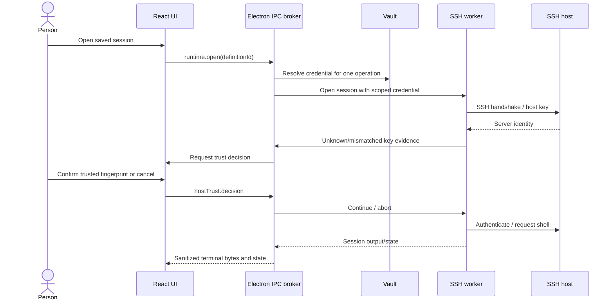

# SPEC-001-MultiRemoteTerminal

**Status:** Approved design baseline; implementation is in progress and acceptance is tracked in `docs/FEATURE-MATRIX.md`
**Platform:** Windows x64 desktop  
**Product type:** Personal remote-management workstation  
**Source specification date:** 2026-10-23

## Background

The user wants an independent Windows remote-terminal workbench with the capabilities defined in this specification. The new product is named **MultiRemoteTerminal** and is developed in the GitHub repository `AKeybladeMaster/MultiRemoteTerminal`. The active development branch is `dev`; reviewed phases are merged into the default `main` branch with history preserved.

The comparison application's publicly advertised features include tabbed local terminals, SSH/Telnet/Rlogin/Mosh, RDP/VNC/XDMCP, SFTP browser, X11 forwarding/server, SSH gateways and tunnels, multi-execution, macros, local tools, text editing, master-password storage, syntax highlighting and professional customizer settings. The official edition table additionally describes no limits on stored sessions/tunnels/macros, unlimited network-daemon runtime, startup message/logo, user profile script and enabled-tool selection.

**Product boundary:** Build equivalent workflows independently. No reused proprietary binary/code/design assets, bypasses of license controls, copyrighted artwork or branded imitation. Supporting third-party tools are permitted only after license and redistributability review. REA research is observational with an evidence trail, never an instruction to extract reusable proprietary implementation.

## Requirements

Priority labels: **Must** = MVP release gate; **Should** = next public-quality release; **Could** = parity milestone; **Won't in MVP** = explicitly deferred while staying in full-scope backlog.

### Product and functional (MoSCoW)

| ID | Priority | Requirement | Testable exit criterion |
|---|---|---|---|
| F-001 | Must | Windows installer and portable app | Win10/11 x64 smoke; installer uninstall; portable stores data in opt-in portable folder |
| F-002 | Must | Tabbed local terminal with PowerShell/cmd and optional installed Git Bash | ConPTY input/resize/Unicode/paste/tab lifecycle functional for each available shell; missing Git Bash is reported clearly |
| F-003 (PARTIAL) | Must | SSH terminal with password authentication and host verification | Windows loopback E2E covers host trust, password terminal I/O, transport reset and saved-profile reconnect. WP-02A verifies encrypted Ed25519 private-key authentication for the terminal and a separate standalone SFTP files-only connection; WP-02B exercises SSH agent signing and standalone SFTP through a temporary Windows named pipe. WP-04I verifies the mock agent at terminal and SFTP destinations through three gateways. All key and agent loopback fixtures use ssh2 and do not replace disposable OpenSSH interoperability acceptance. Actual Windows OpenSSH agent service interoperability, disposable OpenSSH interoperability and packaged native credential prompting remain open. See [WP-02A](results/WP-02A-ssh-private-key-auth-2026-10-26.md), [WP-02B](results/WP-02B-ssh-agent-auth-2026-10-26.md) and [WP-04I](results/WP-04I-routed-ssh-agent-auth-2026-10-27.md) |
| F-004 (VERIFIED) | Must | Unlimited saved sessions and folders | Windows acceptance imports, searches, reopens and deletes among 1,000 definitions; SQLite coverage creates and manages 1,009 without fixed caps. See [WP-03F evidence](results/WP-03F-session-scale-2026-10-25.md). |
| F-005 | Must | Automatic configurable SFTP side browser | SSH login opens navigable remote files; upload/download/cancel/collision tests. WP-05A implements contextual listing/navigation; WP-05B adds contextual transfer and Windows loopback evidence; WP-05C adds standalone files-only SSH/SFTP sessions with first-use host trust, download, saved-profile reopen and no shell request; WP-05E adds bounded local-file drag/drop into the active SFTP/FTP folder with sender/session/path-bound opaque handles and a Windows loopback SFTP byte check; WP-05F verifies 1 KiB SFTP/FTP drops and 100 MiB SFTP-download and FTP-upload/download byte integrity; WP-05G verifies a 100 MiB SFTP drop upload by exact size and SHA-256; WP-05H and WP-05I verify local staging cleanup and explicit reconnect/retry after interrupted SFTP and FTP downloads; WP-05J verifies the persisted setting that controls the contextual SSH file pane while preserving standalone files-only tabs. WP-05K verifies interrupted SFTP upload stage cleanup and explicit retry only after reconnect to the same trusted route while the SSH utility worker remains alive; forced worker termination and application restart can still leave residue. WP-05L verifies interrupted FTP upload-stage cleanup and exact-byte retry only after reconnect to the same endpoint, TLS mode and username while the FTP utility worker remains alive; worker termination and application restart can still leave FTP residue. FTP SIZE also cannot distinguish a smaller same-path replacement before reconnect. F-005 remains PARTIAL until native Explorer gesture automation, sustained throughput and broader interoperability are covered. See [WP-05A](results/WP-05A-sftp-directory-browser-2026-10-24.md), [WP-05B](results/WP-05B-sftp-transfers-2026-10-24.md), [WP-05C](results/WP-05C-sftp-only-sessions-2026-10-24.md), [WP-05E](results/WP-05E-sftp-file-drop-2026-10-26.md), [WP-05F](results/WP-05F-large-file-acceptance-2026-10-26.md), [WP-05G](results/WP-05G-sftp-large-upload-2026-10-26.md), [WP-05H](results/WP-05H-sftp-download-recovery-2026-10-26.md), [WP-05I](results/WP-05I-ftp-download-recovery-2026-10-26.md), [WP-05J](results/WP-05J-configurable-sftp-side-pane-2026-10-26.md), [WP-05K](results/WP-05K-sftp-upload-recovery-2026-10-26.md), [WP-05L](results/WP-05L-ftp-upload-recovery-2026-10-26.md), [ADR-0008](adr/ADR-0008-sftp-only-sessions.md), and [ADR-0025](adr/ADR-0025-preload-file-drops.md). |
| F-006 | Must | SSH local/remote/dynamic tunnels and status | Each tunnel mode tested; 20 records; port conflict handled; no application count cap. WP-04A/B/C cover local, loopback-requested remote and no-auth SOCKS5 TCP CONNECT forwarding; WP-04F/G verify all three modes through two gateways and WP-04H verifies local, remote and dynamic routes through three gateways. Non-loopback consent, UDP/BIND and broad tunnel interoperability remain open. |
| F-007 | Must | Unlimited structured macros; keyboard shortcuts | 100 macros store/replay; cancellations; secret-exclusion behavior. WP-06A adds the persistent typed library. WP-06B1 records complete input lines for one selected terminal, omits paste and suppresses input after recognized secret prompts with an automatic pause; prompt detection is heuristic. WP-06B2 adds explicit single-terminal preview and playback with literal waits, bounded delays, inline confirmations, progress, cancellation and disconnect stop. WP-06D's Windows E2E stores 100 definitions, restarts the app, reloads the catalog and replays each definition through the workbench. WP-06E adds persistent macro-specific keyboard bindings that open the exact review without running it. WP-06F verifies SSH/Telnet loopback macro playback. F-007 remains PARTIAL because secret-prompt coverage is heuristic and broader public-server playback interoperability remains open. See [WP-06 plan](IMPLEMENTATION-PLAN.md#wp-06--macros-and-multiexec), [WP-06B1 evidence](results/WP-06B1-macro-recording-2026-10-25.md), [WP-06B2 evidence](results/WP-06B2-macro-playback-2026-10-25.md), [WP-06D evidence](results/WP-06D-macro-100-replay-2026-10-25.md), [WP-06E evidence](results/WP-06E-macro-keyboard-shortcuts-2026-10-25.md) and [WP-06F evidence](results/WP-06F-remote-macro-playback-2026-10-25.md). |
| F-008 | Must | MultiExec across selected active terminals | VERIFIED: Windows E2E reviews the exact line and confirms once before delivery to three independent SSH hosts; each host records exactly one copy. Unit tests verify target isolation, no automatic retries, uncertain delivery and queued cancellation. See [WP-06C evidence](results/WP-06C-multiexec-2026-10-25.md). |
| F-009 | Must | Startup greeting/logo/profile script/tool visibility | Settings persist; invalid logo path handled; profile load never silently executes. P-36 implements bounded local PowerShell script text with exact preview and an explicit trusted per-session run; it does not edit or auto-run the standard `$PROFILE`. WP-11C adds persisted availability controls for a fixed set of optional providers. F-009 remains incomplete while native logo-dialog acceptance and shell/tool lifecycle controls remain open. |
| F-010 | Must | OS-protected credentials, master password option | Default encrypted storage; vault lock/unlock; secret never sent to renderer. WP-07R adds explicit saved SSH password management, main-process resolution for the exact saved endpoint, Windows-account-protected storage, and user-facing lock/unlock controls. Its Windows loopback E2E verifies lock rejection, unlock recovery, saved-profile authentication without another prompt, and exclusion from renderer output, saved rows, exports, profile files and application console. WP-07K adds synthetic session-lock event acceptance; WP-07L verifies same-profile restart persistence with real Windows `safeStorage`. WP-07S adds the optional Argon2id/XChaCha master-password vault, atomic mode conversion, restart locking, explicit reset and reset reference cleanup; the Windows E2E exercises the real KDF utility process. WP-07T verifies copying a master-password vault into a distinct app profile directory under the same Windows account, locked startup and unlock before credential resolution. F-010 remains PARTIAL pending physical Windows session-lock, cross-account and DPAPI-mode migration/restore, remaining credential flows and broader security acceptance. See [WP-07T evidence](results/WP-07T-master-vault-profile-restore-2026-10-26.md), [WP-07S evidence](results/WP-07S-master-password-vault-2026-10-26.md), [WP-07R evidence](results/WP-07R-saved-ssh-credentials-2026-10-25.md), [WP-07K evidence](results/WP-07K-vault-lock-recovery-2026-10-25.md) and [WP-07L evidence](results/WP-07L-vault-restart-2026-10-25.md). |
| F-011 | Must | SSH gateways / jump-host route | WP-04D supports saved SSH terminal targets; WP-04E extends this to saved SFTP-only targets; WP-04F/G cover saved tunnel routes; WP-04H raises each route to at most three ordered saved SSH gateways. Windows E2E verifies one-, two- and three-hop terminal routes, SFTP-only routes, and local, remote and dynamic tunnel routes through three gateways, including independent host trust, output/listing/exact forwarded bytes, target-only shell/SFTP behavior, no PTY/shell/SFTP for tunnel routes, and cleanup. WP-04I adds mock-agent authentication at terminal and SFTP destinations through three gateways. Routes longer than three hops and broad public-server interoperability remain open, so F-011 is PARTIAL. See [WP-04E results](results/WP-04E-sftp-only-ssh-gateway-routes-2026-10-26.md), [WP-04F results](results/WP-04F-tunnels-through-ssh-gateways-2026-10-26.md), [WP-04G results](results/WP-04G-routed-tunnel-modes-2026-10-26.md), [WP-04H results](results/WP-04H-three-gateway-routes-2026-10-26.md), [WP-04I results](results/WP-04I-routed-ssh-agent-auth-2026-10-27.md) and [ADR-0034](adr/ADR-0034-wp04h-three-gateway-routes.md). |
| F-012 | Must | Enhanced baseline security | IPC sandbox, strict host keys, non-loopback tunnel warnings, no plaintext log |
| F-013 | Must | No arbitrary limits or daemon-runtime timers | Schema/config show no caps; smoke confirms persisted records; opt-in Windows TFTP E2E remains running beyond 360 s and then stops explicitly with no app-imposed service timeout |
| F-014 (PARTIAL) | Should | Local/remote text editor and syntax color profiles | WP-08C covers conflict-checked SFTP editing; WP-08D adds bounded local UTF-8 editing with explicit save/reload and conflict protection; WP-08E adds auto-detected/overridable Shell and JSON syntax color previews for both editors. Broader language profiles, terminal shell grammar and optional autosave remain open; see WP-08C/WP-08D/WP-08E evidence. |
| F-015 | Should | Remote desktop sessions: RDP and VNC | Supported external viewer launch, credential warnings, reconnect/error UX |
| F-016 | Should | Serial and FTP/FTPS | COM port enumeration and serial settings; FTP/FTPS browse and transfer; plaintext FTP warning. WP-09C adds credential-free FTP profiles and browsing; WP-09D adds FTP transfer with progress, cancellation and conflict handling; WP-09F verifies normal FTPS certificate rejection/trust and TLS-protected control/data flows against a local fixture; WP-09G verifies TLS data-channel session reuse against the controlled fixture. WP-09E adds an isolated, mock-verified serial terminal and explicit Windows COM port selection; WP-09E.1 adds persistent serial profiles and credential-free folder bundle v6 export/import with version 1–5 compatibility. F-016 remains PARTIAL until physical-device and hot-unplug acceptance, driver-signature review, and broader FTPS interoperability are covered. See [WP-09E evidence](results/WP-09E-serial-2026-10-25.md), [WP-09E.1 evidence](results/WP-09E1-serial-profiles-2026-10-25.md), [WP-09F evidence](results/WP-09F-ftps-tls-acceptance-2026-10-26.md), and [WP-09G evidence](results/WP-09G-ftps-session-resumption-2026-10-26.md). |
| F-017 | Should | Plugins/provider discovery | WP-11C lets the user enable/disable a fixed set of built-in, app-owned optional providers without arbitrary JS execution. Signed third-party provider discovery, installation and update remain open. |
| F-018 | Should | Secure import/export + settings profile templates | Roundtrip non-secret config; encrypted user-opt-in secret export |
| F-019 | Could | Mosh and Telnet/Rlogin | True protocol negotiation, end-to-end fixture per protocol |
| F-020 | Could | Integrated or licensed X server and X11 forwarding | Real remote `xclock`/GUI rendering with SSH-forwarded X11 |
| F-021 | Could | XDMCP remote Unix desktop, extensions | Actual session through compatible provider, documented extension support |
| F-022 | Could | Network daemons: TFTP, NFS, Cron and helpers | User-scope services have an explicit start/stop lifecycle, secure default binding, bounded protocol work and no application-imposed runtime limit. WP-10A covers only an opt-in, read-only TFTP slice: bind only to 127.0.0.1; serve top-level regular files in octet mode; decode request filenames as strict UTF-8 and accept Windows-legal single components up to 255 UTF-16 code units within a 1,024-byte request limit; reject writes, traversal, links and oversized files; show the unauthenticated local-read warning. Windows E2E verifies a 1 KiB exact-byte RRQ, runtime oversized-file rejection, eight active RRQs held without ACKs and a bounded ninth-request error, loopback transfer IDs, service lifetime beyond 360 seconds, active-transfer stop, restart and shutdown cleanup. A focused Windows UDP test verifies a long Unicode filename transfers exact bytes. A mixed-load worker UDP test keeps 7 transfers active while 8 file opens are pending, rejects request 9, then verifies only one pending transfer fills the last active slot and the others receive busy errors; broader packet-storm behavior is not claimed. File-symlink rejection remains unverified because the current Windows account denies symlink creation with EPERM. The earlier ACK timeout is not currently reproducible; broader interoperability, machine-to-machine exposure/isolation and NFS/Cron/helper daemons remain open, so F-022 remains partial. |
| F-023 | Could | Embedded utilities and Unix commands | WSL/system tool integration plus optional licensed utility packages |
| F-024 | Could | Portable scripting/tool bundles and advanced appearance | Configurable package sources; licensing verified; no unsafe remote auto-install |
| F-025 | Won't in MVP | Full in-window RDP/VNC/X11 embedding | External provider route first; optional later integration after technical validation |
| F-026 | Won't in MVP | Clone MobaXterm's precise look, bundle, or MobApt internals | Independent UX and implementation only |

**Clarification:** MVP includes the professional *settings and unlimited record counts* but is not full protocol parity. Marketing and documentation must not call it "all features" until F-019..F-024 plus corresponding parity matrix gates have passed.

### Non-functional

| ID | Priority | Requirement | Target / proof |
|---|---|---|---|
| N-001 | Must | Windows reliability | Recover cleanly from lost SSH, crashed PTY worker, locked vault, file conflict |
| N-002 | Must | Security | Electron official checklist and `docs/SECURITY.md`, independent security review |
| N-003 | Must | No remote execution without user action | Connections and macros only execute after explicit user intent and target selection |
| N-004 | Must | Testability | Fake ports, SSH integration fixture, Windows E2E, no network required for unit suite |
| N-005 | Must | Structured errors | All UI errors have code, target, retryability, no sensitive stack data |
| N-006 | Must | Accessibility | Keyboard operation, focus-visible, labels, 200% DPI smoke, dark/light contrast |
| N-007 | Must | Reproducible builds | Pinned lockfile, pinned tools, dependency SBOM, signed release plan |
| N-008 | Should | Responsiveness | Typing latency p95 under 75ms with 10 idle tabs on reference Windows machine |
| N-009 (PARTIAL) | Should | Scalability | 1,000 saved sessions search p95 below 150ms (verified by WP-03F); 20 active SSH sessions memory profile remains open |
| N-010 | Should | Recoverability | Crash-recovery app config/DB, migration backups, interrupted transfer status |
| N-011 | Could | Offline use | Local terminal, saved settings and help work without internet |
| N-012 | Must | Legal/provenance hygiene | Third-party dependency/asset register and compliance checks per release |

Performance figures are initial **targets**, not measured facts; refine after hardware baseline. Support Windows versions only after real test evidence.

## Method

### Overview and architectural decisions

1. Build a Windows modular monolith rather than cloud service or microservices.
2. Use Electron's sandboxed renderer with React/TypeScript; use preload as a **small allowlisted IPC interface**; Electron main validates and brokers actions.
3. Use independent utility worker processes for network operations, local PTY, and storage, with lifecycle supervision. No shell commands are assembled by concatenating untrusted values.
4. Use clean module direction: domain rules -> application use cases -> adapter interfaces at seams; presentation is driven by use cases and typed view projections.
5. Introduce protocol adapters according to `docs/ARCHITECTURE.md`, with capability probes. External RDP/VNC/X server tools are *provider integrations* initially, not fake embedded implementations.
6. Store normalized session definitions in local SQLite and OS-protected vault secrets separately; use explicit settings and per-user paths.
7. Enforce SSH known-host checking, sandboxed UI, safe SFTP transfers, controlled daemon exposure, no automatic macro replay.

Detailed architecture, IPC family contracts, lifecycle diagrams, schema tables and algorithms: [ARCHITECTURE.md](ARCHITECTURE.md). Security threat model and policy: [SECURITY.md](SECURITY.md). Comprehensive edition coverage: [FEATURE-MATRIX.md](FEATURE-MATRIX.md).

### Canonical workflow

Trust decisions require an explicit user action and must not default to acceptance. The broker does not log credentials or terminal command contents.

### Existing applications and inspiration

- MobaXterm: publicly advertised workflow benchmark; **not** source or asset source.
- Windows Terminal: modern tabs/panes and ConPTY expectations.
- OpenSSH: interoperability and known-host semantics reference.
- PuTTY / KiTTY / WinSCP: comparative testing for SSH/serial and graphical transfers.
- Royal TS / Termius: connection organization reference points.

Study interaction patterns and user-visible behavior rather than copying styles, proprietary file formats or internal code. An evidence-based feature checklist replaces assumptions.

## Implementation

Build **vertical slices** in this sequence; every slice must pass tests before expansion. See [IMPLEMENTATION-PLAN.md](IMPLEMENTATION-PLAN.md).

1. **Foundation:** workspace, Electron security posture, typed preload/IPC, app shell, design tokens and CI checks; source work proceeds on `dev` before reviewed promotion to `main`.
2. **Terminal/SSH:** ConPTY/PTY lifecycle, SSH shell, known-host trust dialog, credential vault, tabs, error states.
3. **Catalog:** SQLite schemas and migrations, folders/sessions, filters, backup, import/export redacted defaults.
4. **SFTP and forwarding:** remote file browser, transfers, jumps, local/remote/dynamic SSH tunnels.
5. **Power features:** macros, MultiExec safety, profile script settings, logo/greeting, remove/enable tool entries, text highlight.
6. **Hardening/release:** review, E2E Windows installers, signing plan, portable mode, crash tests, docs.
7. **Parity extensions:** RDP/VNC providers; serial/FTP; true Mosh and legacy; X11/XDMCP; daemons and Unix utilities.

No step may be marked done because it has only stub UI or scaffolding.

## Milestones

| Milestone | Gate | Deliverable |
|---|---|---|
| M0 — Design baseline | Docs approved | This spec, architecture, skill playbook, feature matrix, ADRs |
| M1 — Secure shell foundation | F-001/002/003/010/012 | Windows local/SSH workbench with trust/vault |
| M2 — Remote operations MVP | F-004/005/006/011 | Session catalog, SFTP, forwarding/jump tests |
| M3 — Power-user MVP | F-007/008/009/013 | Macros, MultiExec, professional settings, unlimited records |
| M4 — v0.1 ready | N-001..N-007 | Installed/portable build E2E, no critical findings, reviewed `dev`→`main` promotion |
| M5 — Remote desktop/legacy | F-014..F-019 | RDP/VNC/serial/FTP/Mosh/legacy |
| M6 — Full parity candidate | F-020..F-024 | X server/XDMCP/daemons/tooling tested on Windows |

Do not promise calendar deadlines before available team/runtime/testing resources are known.

## Gathering Results

Track features by requirement ID, protocol fixture, Windows version, automated test, human confirmation, caveats and implementation evidence. Collect:

- Connection success/failure rates and p95 startup time per protocol on local test network (no user telemetry by default).
- Resource behavior at 10 and 20 concurrent sessions, tunnel counts and 1,000+ saved sessions.
- Host-key mismatch prevention, default loopback exposure, vault lock and corrupted vault resilience.
- SFTP integrity under transfer cancellation, network loss and overwrite conflicts.
- Keyboard navigation and visual regression across 100%/200% DPI and themes.
- Daemon longevity tests longer than 360 seconds **once implemented**, without unintended exposure.
- A legal compliance checklist for every third-party binary and redistributed library.

**Definition of full parity candidate:** All accepted features in `FEATURE-MATRIX.md` pass their real-protocol test; any feature that relies on an external app is transparently labeled, and any weaker implementation remains an open gap.

## Need Professional Help in Developing Your Architecture?

Please contact me at [sammuti.com](https://sammuti.com) :)
